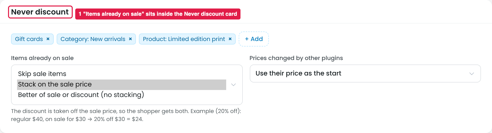
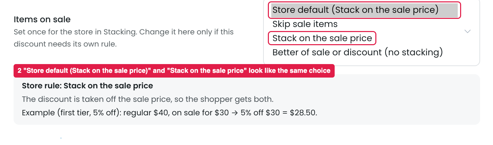

# Items already on sale: where it's set and how the builder offers it

The store decides once what happens to items that are already on sale: skip them, stack the discount on the sale price, or give the better of the two. It's set in Stacking, and each discount can override it in its Products step.

## Issue 1: Stacking

**Steps:** Stacking → Never discount → Items already on sale

1. **The setting sits inside the "Never discount" card (marker 1).** Never discount is a list of excluded products (Gift cards, New arrivals…). "Items already on sale" isn't an exclusion: with "Stack" or "Better of", sale items do get discounts. An owner looking for it won't expect it under Never discount.

## Issue 2: Discount builder

**Steps:** Campaigns → Discounts → Buy more, save more → Products → Items on sale

2. **"Store default (Stack on the sale price)" and "Stack on the sale price" look like the same choice (marker 2).** Both give the same price today. The difference is hidden: Store default follows the store rule if it changes later, while "Stack on the sale price" stays fixed for this discount. Nothing tells the owner that.

## Suggestion

- **Move "Items already on sale" out of the Never discount card.** Give it its own small card in Stacking, e.g. **"Sale items"**, next to "Prices changed by other plugins".
- **In the builder, split the choice into two steps:**
  - ○ **Use the store rule** (Stack on the sale price), with the note *"Follows Stacking. If the store rule changes, this discount changes too."*
  - ○ **Set a rule for this discount only:** [Skip sale items / Stack on the sale price / Better of sale or discount]

  Then "Stack on the sale price" only appears as a fixed choice, and the difference is clear.
