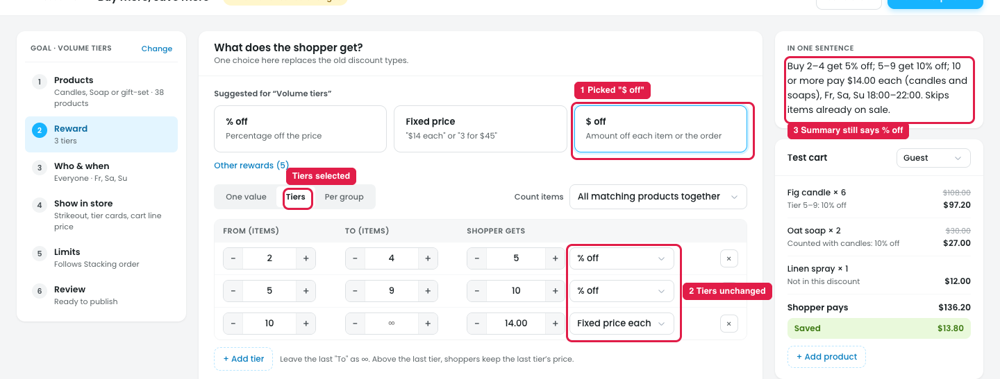
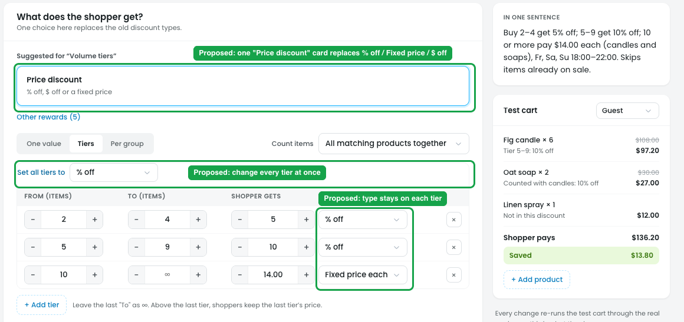

# Reward: picking a suggested type doesn't change the tiers

## Issue

**Steps:** Campaigns → Discounts → Buy more, save more → Reward → Tiers → Suggested for "Volume tiers" → $ off

With **Tiers** selected, picking a suggested type only highlights the card:

1. **"$ off" is picked (marker 1),** and the card is highlighted.
2. **The tiers don't change (marker 2).** They still say **% off / % off / Fixed price each**. The same happens with "Fixed price" and "% off": no tier follows the card.
3. **The summary doesn't change either (marker 3).** "In one sentence" still says "get 5% off; … get 10% off; … pay $14.00 each", so the card and the tiers disagree.

The owner can't tell which one is used: the card, or the type on each tier.

## Suggestion

**Steps:** Campaigns → Discounts → Buy more, save more → Reward → Tiers (proposed)

**Merge the 3 cards (% off, Fixed price, $ off) into one card: "Price discount".**

**Why:**
- **Syncing the cards doesn't fix it.** Suppose picking "$ off" set every tier to $ off each. If the owner then changes one tier to "Fixed price each", the "$ off" card stays selected while that tier isn't $ off, and the screen is confusing again.
- **The 3 cards are one kind of reward.** % off, $ off and Fixed price are all a price discount; only the type differs.
- **The type is already set on each tier.** Each tier has its own type dropdown, so the type belongs there, next to the value. With one card, nothing can disagree with the tiers.

- **The card:** **Price discount** · *"% off, $ off or a fixed price"*. It sits next to the other reward types (free item, free shipping…), which stay under "Other rewards".
- **One value:** the type goes beside the value: `[10] [% off ▾]`.
- **Tiers:** each row keeps its own type, as now:
  - `2–4 → [5] [% off ▾]`
  - `5–9 → [10] [% off ▾]`
  - `10+ → [14.00] [Fixed price each ▾]`
- **Per group:** the same, with one type per group row.
- **Change all tiers at once:** a small link above the tiers, *"Set all tiers to [% off ▾]"*.
- **Starting type comes from the template:** Volume tiers starts with % off, and "Set a fixed price" starts with Fixed price each. The owner changes it in the dropdown.
- **The summary and test cart** always follow the tier types.
