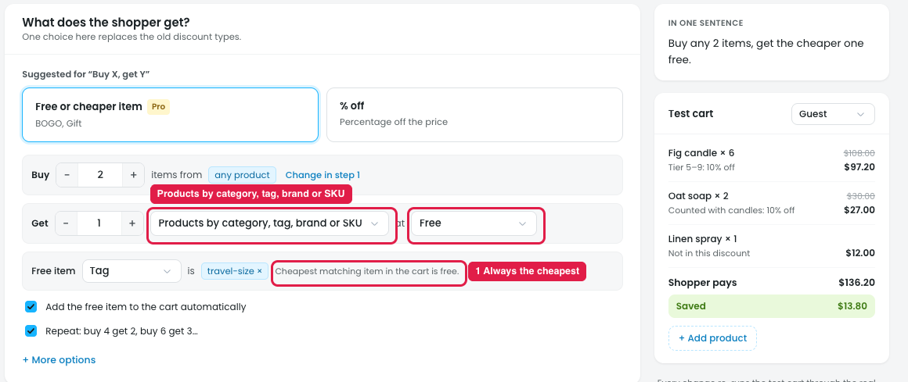
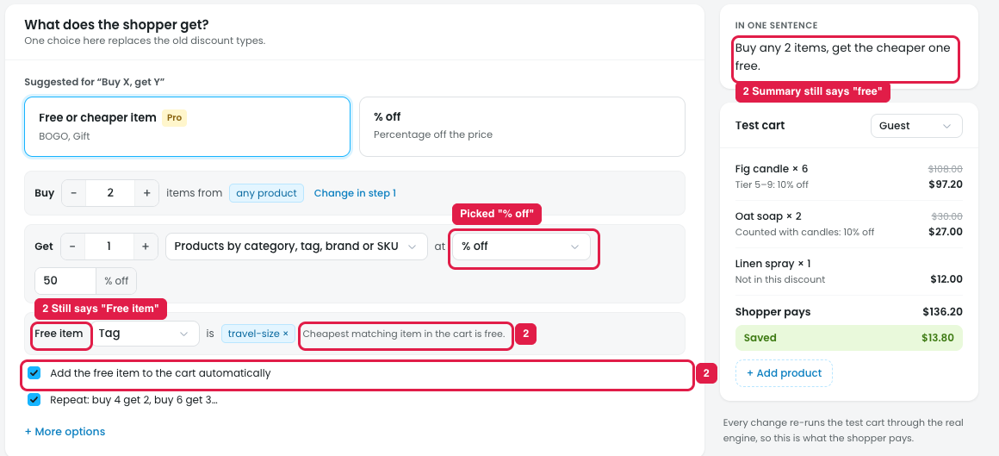

# Reward: Free or cheaper item picked by category, tag, brand or SKU

## Issue 1: No choice of which matching item is free

**Steps:** Campaigns → Discounts → New discount → Buy X, get Y → Reward → Free or cheaper item → Get → Products by category, tag, brand or SKU → at Free

1. **The free item is always the cheapest one (marker 1).** When the rule (e.g. Tag is travel-size) matches several items in the cart, the line only says "Cheapest matching item in the cart is free." The owner can't choose the most expensive (highest value) matching item instead.

## Issue 2: The "Free item" wording stays after picking a discount type

**Steps:** Campaigns → Discounts → New discount → Buy X, get Y → Reward → Free or cheaper item → Get → Products by category, tag, brand or SKU → at % off

2. **After switching "at Free" to "% off" (50% off), the text still talks about a free item (marker 2):**
   - The row title says **"Free item"**.
   - The line says **"Cheapest matching item in the cart is free."**
   - The checkbox says **"Add the free item to the cart automatically"**.
   - "In one sentence" says **"get the cheaper one free"**.

   The item is now 50% off, not free.

## Suggestion

- **Add a choice for which matching item gets the reward:**
  `If more than one item matches: [Cheapest ▾]`, with the options **Cheapest** and **Most expensive (highest value)**. Then update the line, e.g. *"Most expensive matching item in the cart is free."*
- **Make the wording follow the discount type:**

  | at | Row title | Line | Checkbox |
  |---|---|---|---|
  | Free | **Free item** | "Cheapest matching item in the cart is free." | "Add the free item to the cart automatically" |
  | % off / $ off / fixed price | **Discounted item** | "Cheapest matching item in the cart gets 50% off." | "Add the discounted item to the cart automatically" |

  "In one sentence" follows too: *"Buy 2 items, get the cheapest travel-size item at 50% off."*
