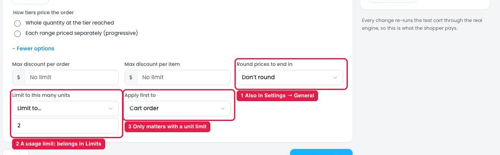
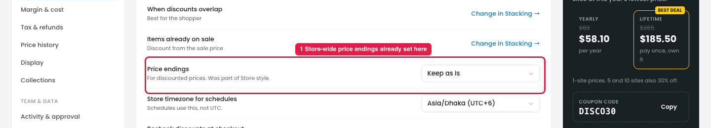
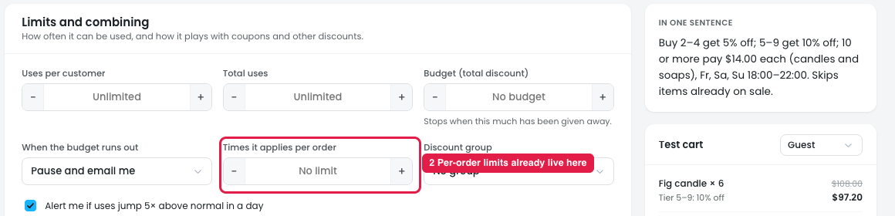

# Reward → More options: settings that belong elsewhere

## Issue 1: Reward → More options

**Steps:** Campaigns → Discounts → Buy more, save more → Reward → + More options → Limit to this many units → Limit to…

1. **"Round prices to end in" repeats a store setting (marker 1).** Settings → General already has **Price endings** (Issue 2). The two have different options:
   - Reward: Don't round / .99 / .95 / .90 / .00
   - Settings: Keep as is / End in .99 / Round to whole numbers

   It isn't clear which one wins when both are set.
2. **"Limit to this many units" is a usage limit, not a reward (marker 2).** It caps how many units get the discount per order. The Limits step already has "Times it applies per order" and the other caps (Issue 3).
3. **"Apply first to" (Cart order / Cheapest first / Most expensive first) only appears once a unit limit is set (marker 3).** It decides which units get the discount when only some can. On its own in Reward, it's unclear what it applies to.

## Issue 2: Settings → General → Price endings

**Steps:** Settings → General → Price endings

1. **Price endings are already set store-wide here (marker 1),** for discounted prices: Keep as is / End in .99 / Round to whole numbers.

## Issue 3: Limits

**Steps:** Campaigns → Discounts → Buy more, save more → Limits

2. **Per-order limits already live here (marker 2):** "Times it applies per order", next to Uses per customer, Total uses and Budget.

## Suggestion

- **Remove "Round prices to end in" from Reward.** Use the store-wide **Settings → General → Price endings** for every discount. If one discount ever needs its own rounding, add it as an override in Limits or Advanced, with "Store default (Keep as is)" first.
- **Move "Limit to this many units" to the Limits step,** next to "Times it applies per order": `Units discounted per order: [All matching units ▾ / Up to [2]]`.
- **Remove "Apply first to" from Reward.** When a unit limit is set in Limits, use **Cheapest first** by default and show it as a line under the limit: *"Discount goes to the cheapest units first."* Offer the choice (Cheapest first / Most expensive first) there, but only when a limit is set.
