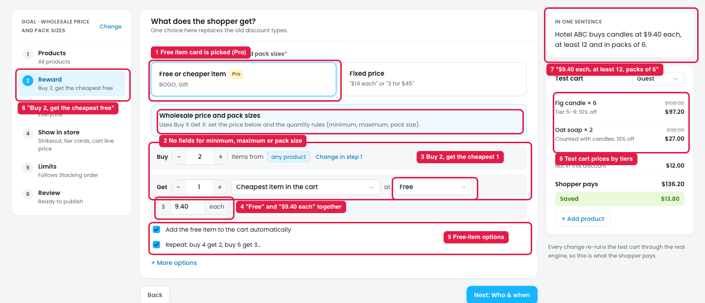
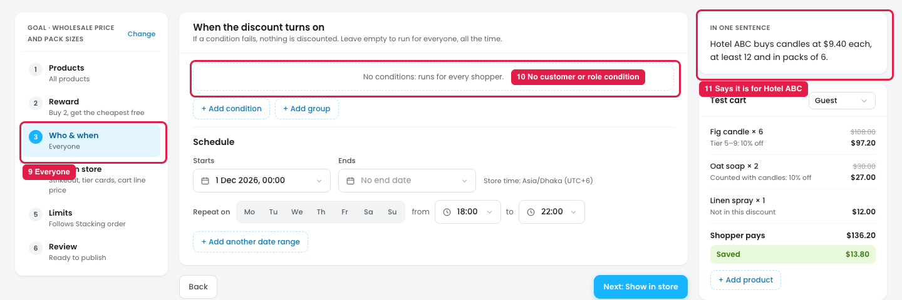
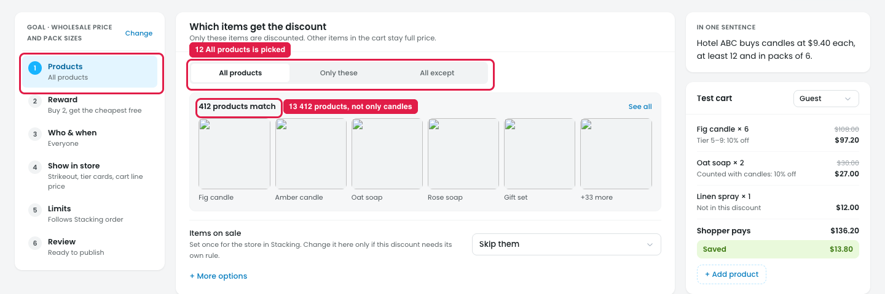
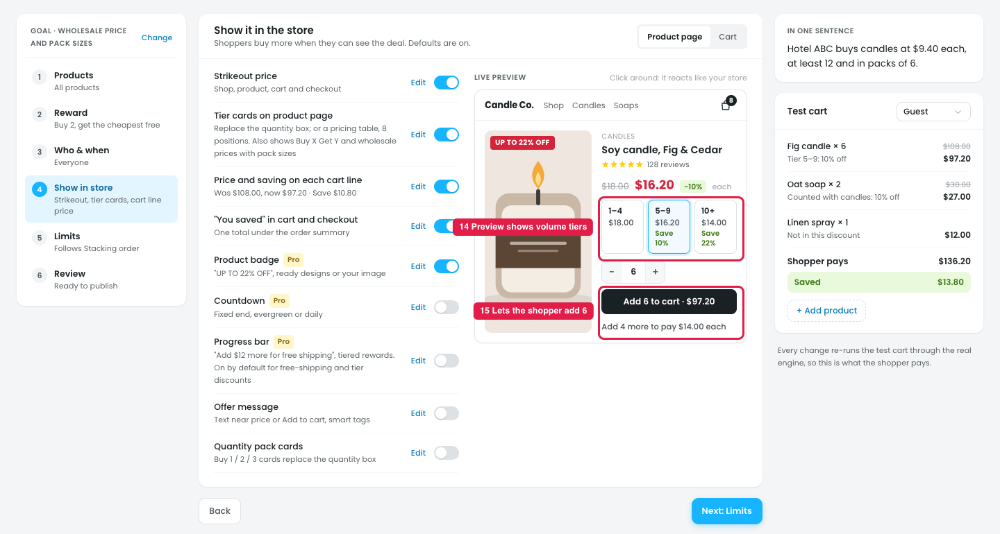

# Template: Wholesale price and pack sizes

The template promises: *"Hotel ABC buys candles at $9.40 each, at least 12 and in packs of 6."* None of the steps it opens is set up that way, and there is nowhere to enter the minimum, maximum or pack size.

## Issue 1: Reward

**Steps:** Campaigns → Discounts → New discount → Wholesale price and pack sizes → Reward

1. **"Free or cheaper item" is the card that is picked (marker 1).** A wholesale price is a fixed price, not a free item. The card also has a **Pro** badge, so a basic wholesale price looks like a paid feature.
2. **There are no fields for the quantity rules (marker 2).** The text says *"set the price below and the quantity rules (minimum, maximum, pack size)"*, but no Minimum, Maximum or Pack size field is shown, here or under + More options.
3. **The rule is "Buy 2, get the cheapest 1" (marker 3).** Buy 2 / Get 1 / Cheapest item in the cart is a BOGO rule. A wholesale price applies to every unit the buyer orders.
4. **"Free" and "$9.40 each" show at the same time (marker 4).** The dropdown says **Free**, but the price box below shows **$ 9.40 each**. The owner can't tell if the item is free or $9.40.
5. **Free-item options are shown and ticked (marker 5):** "Add the free item to the cart automatically" and "Repeat: buy 4 get 2, buy 6 get 3…". They don't apply to a wholesale price.
6. **The step summary says "Buy 2, get the cheapest free" (marker 6),** and Review shows the same.
7. **"In one sentence" says something else (marker 7):** "$9.40 each, at least 12 and in packs of 6". The two summaries disagree.
8. **The test cart prices by volume tiers (marker 8):** "Tier 5–9: 10% off" and "Counted with candles: 10% off". There's no $9.40 price and no pack check (6 candles is under the minimum of 12, but the cart still discounts them).

## Issue 2: Who & when

**Steps:** Campaigns → Discounts → New discount → Wholesale price and pack sizes → Who & when

9. **The step says "Everyone" (marker 9).**
10. **No customer or role condition is set (marker 10):** "No conditions: runs for every shopper."
11. **But the sentence is for one buyer, Hotel ABC (marker 11).** As set, every shopper, including guests, would get the wholesale price.

## Issue 3: Products

**Steps:** Campaigns → Discounts → New discount → Wholesale price and pack sizes → Products

12. **"All products" is picked (marker 12).**
13. **412 products match (marker 13),** while the sentence says the price is for candles.

## Issue 4: Show in store

**Steps:** Campaigns → Discounts → New discount → Wholesale price and pack sizes → Show in store

14. **The live preview shows volume tiers (marker 14):** 1–4 $18.00 / 5–9 $16.20 / 10+ $14.00. It doesn't show the $9.40 wholesale price.
15. **The shopper can add 6 (marker 15):** "Add 6 to cart · $97.20" and "Add 4 more to pay $14.00 each". Nothing says the minimum is 12 or that candles come in packs of 6.

## Suggestion

- **Reward:** open the template on **Fixed price**, not "Free or cheaper item", with no Pro badge for the basic wholesale price.
  - Show one price: `Price [$ 9.40] each`. Remove Buy / Get, the "Which item" dropdown, "Free" and the free-item checkboxes from this template.
  - Add a **Quantity rules** block right under the price, filled from the template:
    `Minimum [12] · Maximum [500] · Sold in packs of [6]`, with the line *"Shoppers must buy at least 12, at most 500, in steps of 6 (6, 12, 18…). The cart shows what's needed; checkout waits until it's right."*
- **Summaries agree:** the step summary, Review and "In one sentence" all read from the same values: *"$9.40 each · min 12 · packs of 6"*.
- **Test cart:** price candles at $9.40 each and show when the quantity breaks a rule, e.g. *"Fig candle × 6: needs at least 12"*.
- **Who & when:** start with a condition, e.g. `Customer role is any of [Wholesale]` (or `Specific customers` for one buyer like Hotel ABC), so a guest doesn't get the wholesale price.
- **Products:** start on **Only these** with an empty list and the note *"Pick the products this wholesale price is for."*
- **Show in store:** preview the wholesale price with its rules: *"$9.40 each · minimum 12 · packs of 6"*, and a quantity box that steps 12, 18, 24…
