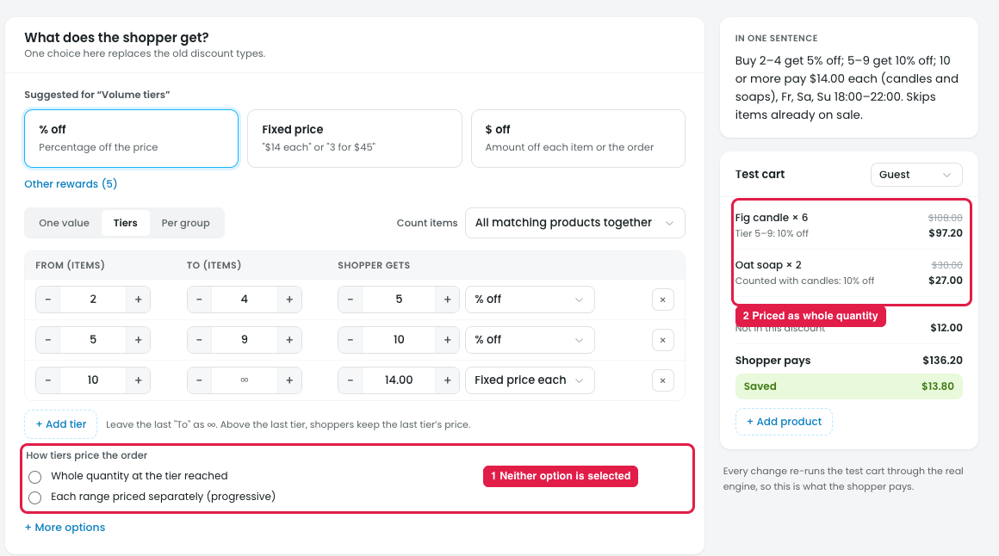

# Reward → Tiers: "How tiers price the order" has no option selected

## Issue

**Steps:** Campaigns → Discounts → Buy more, save more → Reward → Tiers

1. **Neither option is selected (marker 1).** "Whole quantity at the tier reached" and "Each range priced separately (progressive)" are both empty. The same happens with a new discount (Campaigns → Discounts → New discount → Volume tiers → Reward). The owner can't tell how the tiers will price the order, or whether they must pick one before publishing.
2. **The test cart already prices by whole quantity (marker 2).** Fig candle × 6 gets "Tier 5–9: 10% off" on all 6 units, and Oat soap is "Counted with candles: 10% off". So a method is in use, but the radios don't show which.

## Suggestion

- **Select "Whole quantity at the tier reached" by default.** It's the common way volume tiers work, and it's what the test cart and "In one sentence" already use.
- **Let templates set the default:** Volume tiers starts on **Whole quantity**, and Progressive tiers starts on **Each range priced separately**.
- **Add a short example under each option**, so the difference is clear:
  - Whole quantity: *"6 candles: all 6 get 10% off."*
  - Each range: *"6 candles: the 1st at full price, the 2nd–4th at 5% off, the 5th–6th at 10% off."*
- **When the owner switches, update the test cart and "In one sentence"** to the new method.
