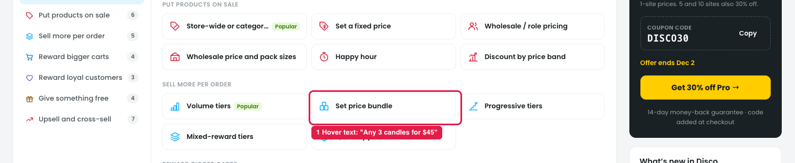
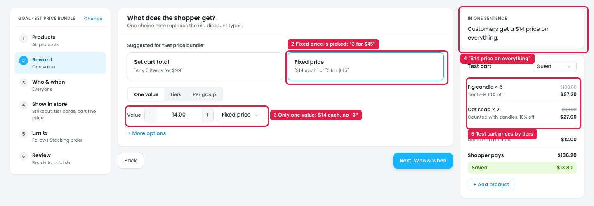
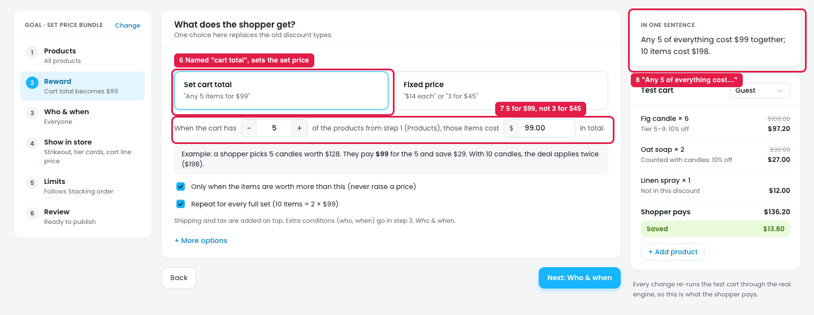
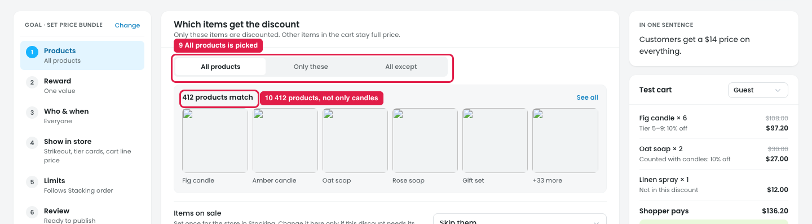

# Template: Set price bundle

The template is for a bundle price: *"Any 3 candles for $45"*. The reward that does this is **Set cart total**. The template opens on **Fixed price** instead, set to $14 each, so the owner gets a per-item price, not a bundle.

## Issue 1: Template card

**Steps:** Campaigns → Discounts → New discount → (hover) Set price bundle

1. **The card promises "Any 3 candles for $45" (marker 1),** shown only as hover text. None of the steps that open use 3 or $45.

## Issue 2: Reward opens on Fixed price

**Steps:** Campaigns → Discounts → New discount → Set price bundle → Reward

2. **"Fixed price" is the picked card (marker 2).** Its text says *"$14 each" or "3 for $45"*, so it looks like the bundle card.
3. **There's only one value (marker 3):** `14.00 Fixed price`. There's no field for the "3", so "3 for $45" can't be set here. The bundle needs **Set cart total**.
4. **"In one sentence" says "Customers get a $14 price on everything" (marker 4).** That's a per-item sale, not a bundle.
5. **The test cart prices by volume tiers (marker 5):** "Tier 5–9: 10% off", "Counted with candles: 10% off".

## Issue 3: Set cart total

**Steps:** Campaigns → Discounts → New discount → Set price bundle → Reward → Set cart total

6. **The name says "cart total", but it sets the price of a set of items (marker 6).** With 5 for $99, a cart of 5 candles and other products isn't $99 in total: only the 5 candles cost $99. "Set cart total" sounds like the whole cart becomes $99.
7. **It starts at 5 for $99 (marker 7),** not the template's 3 for $45.
8. **"In one sentence" reads "Any 5 of everything cost $99 together" (marker 8),** which is hard to read.

## Issue 4: Products

**Steps:** Campaigns → Discounts → New discount → Set price bundle → Products

9. **"All products" is picked (marker 9).**
10. **412 products match (marker 10),** not only candles, as the template says.

## Suggestion

- **Open the template on the bundle reward**, with the template's values: `When the cart has [3] of the products from step 1, those items cost $[45] in total.`
- **Rename "Set cart total" to "Bundle price"**, with the line *"Any 5 items for $99"*. Keep the step summary in the same words: *"Any 3 for $45"*.
- **Fixed price card:** drop *"3 for $45"* from its text and keep *"$14 each"*, so only one card talks about bundles.
- **"In one sentence":** *"Any 3 candles cost $45 together; 6 candles cost $90."* With all products: *"Any 3 items cost $45 together."*
- **Products:** start on **Only these** with Candles, or with an empty list and the note *"Pick the products that can make up the bundle."*
- **Test cart:** show the bundle, e.g. *"Fig candle × 3: bundle of 3, $54.00 → $45.00"*.
