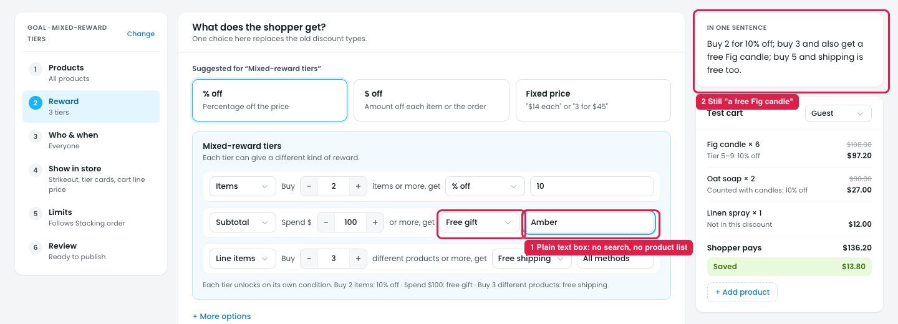

# Mixed-reward tiers: the free gift is typed, not searched

## Issue

**Steps:** Campaigns → Discounts → New discount → Mixed-reward tiers → Reward → Spend $100 → Free gift → type "Amber"

1. **The gift is a plain text box (marker 1).** With **Free gift** picked, the box next to it holds the text "Fig candle". Typing "Amber" shows no search results and no product list, so the owner has to know and type the exact product name. Nothing checks that the product exists, has stock, or is spelled right.
2. **"In one sentence" doesn't follow (marker 2).** After typing "Amber", it still says *"get a free Fig candle"*. Since the box is free text, it isn't tied to a real product.

## Suggestion

- **Make the gift a product search,** like the product picker in Products: type to search by name or SKU, and see a list with image, price and stock.
  - `Free gift: [🔍 Search products…]` → *Amber candle · $18.00 · 24 in stock*
  - Show the picked product as a chip with an ×, e.g. `[Amber candle ×]`.
- **Allow more than one gift,** and let the shopper choose, as in Buy X, get Y → Gift list (shopper chooses).
- **Warn on a problem:** *"Out of stock: the gift won't be added."*
- **Use the picked product everywhere:** "In one sentence", the step summary, the test cart and the store preview.
