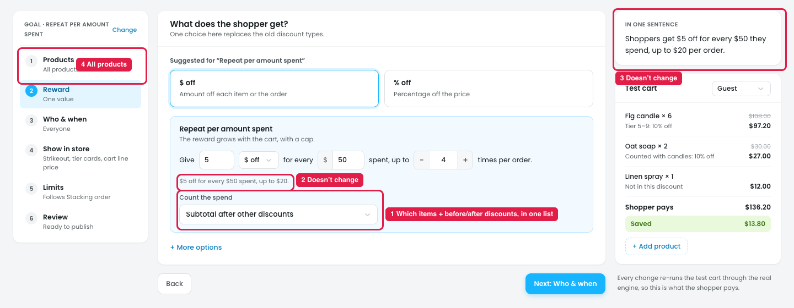

# Repeat per amount spent: "Count the spend" is unclear

"Count the spend" decides which money in the cart counts toward each "$50 spent". For the rule *$5 off for every $50 spent, up to 4 times*, take a cart with candles at $60 (picked in step 1), a linen spray at $45 (not in step 1), and another discount that already takes $10 off the candles:

| Count the spend | Spend counted | $50 steps | Shopper gets |
|---|---|---|---|
| Subtotal before tax | $60 + $45 = $105 | 2 | $10 off |
| Subtotal after other discounts | $105 − $10 = $95 | 1 | $5 off |
| Only the products picked in step 1 | $60 | 1 | $5 off |

## Issue

**Steps:** Campaigns → Discounts → New discount → Repeat per amount spent → Reward → Count the spend → Subtotal after other discounts

1. **One list answers two questions (marker 1).** It mixes *which items count* (the whole cart, or only the products from step 1) with *whether other discounts are taken off first*. With "Only the products picked in step 1", the owner can't tell whether other discounts are taken off. Nothing says if shipping counts, or if a coupon is an "other discount".
2. **The summary under the rule doesn't change (marker 2).** After picking "Subtotal after other discounts", it still says "$5 off for every $50 spent, up to $20." The test cart doesn't change either ($136.20).
3. **"In one sentence" doesn't change (marker 3).** It still says "for every $50 they spend", with no hint of what counts as spend.
4. **Products is "All products" (marker 4),** so "Only the products picked in step 1" gives the same result as "Subtotal before tax". The first two options also count products outside step 1, while the Products step says "Only these items are discounted".

## Suggestion

- **Split it into two choices:**
  - **Count:** `All items in the cart` / `Only the products from step 1`
  - **Other discounts:** `Count the price before them` / `Count the price after them`
- **Say what's never counted:** *"Tax and shipping are not counted."*
- **Show a live example under the choices,** from the test cart: *"This cart counts $95 → 1 × $5 off."*
- **Make the summary, "In one sentence" and the test cart follow the choice,** e.g. *"Shoppers get $5 off for every $50 spent on candles and soaps, after other discounts, up to $20 per order."*
