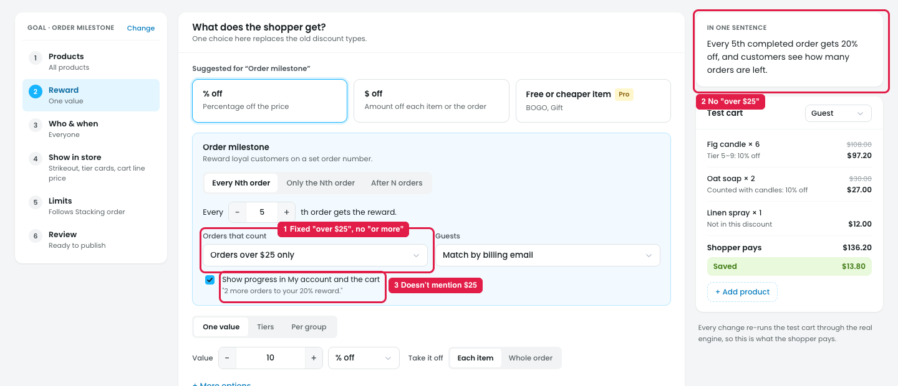

# Order milestone: the minimum order is fixed at $25

A minimum order stops shoppers from reaching the milestone with tiny orders. Without one, 4 orders of a $2 matchbox could unlock 20% off a big 5th order. The idea is useful, but the amount can't be set.

## Issue

**Steps:** Campaigns → Discounts → New discount → Order milestone → Reward → Orders that count → Orders over $25 only

1. **$25 is fixed (marker 1).** It's part of the option text, and picking it shows no amount field. A store selling $200 items can't require "over $200", and a store selling $10 items can't lower it. The same list also holds the order status (Completed / Completed and processing), so the owner can't pick a status and a minimum together. Nothing says if the $25 is before or after discounts, or with or without shipping and tax.
   - **There's no "or more" (marker 1).** "Over $25" means *more than* $25, so an order of exactly $25.00 doesn't count. With a $200 minimum, a $200.00 order (2 × $100 items) wouldn't count either, though most owners expect it to. The owner can't pick **"$200 or more"**, and the shopper isn't told why that order was skipped.
2. **"In one sentence" ignores it (marker 2).** It still says "Every 5th completed order gets 20% off…", with no "over $25".
3. **The progress message doesn't mention it (marker 3):** "2 more orders to your 20% reward." A shopper may expect a $10 order to count.

## Suggestion

- **Split the list into two settings:**
  - **Orders that count:** `Completed orders ▾` / `Completed and processing` (status only)
  - **Minimum order to count:** `[At least ▾] $ [200]`, optional (empty = any amount), with the note *"Order subtotal after discounts, before shipping and tax."*

    | Option | Meaning | $200.00 order |
    |---|---|---|
    | **At least** (default) | $200 or more | counts |
    | **More than** | over $200 | doesn't count |

    An "exactly $200" option isn't needed: almost no order totals exactly that amount.
- The v2 design already does this elsewhere: an **"Orders over a set amount"** option that opens an amount box. Use the same pattern here.
- **"In one sentence":** *"Every 5th completed order of $200 or more gets 20% off…"*
- **Progress message:** *"2 more orders of $200 or more to your 20% reward."*
