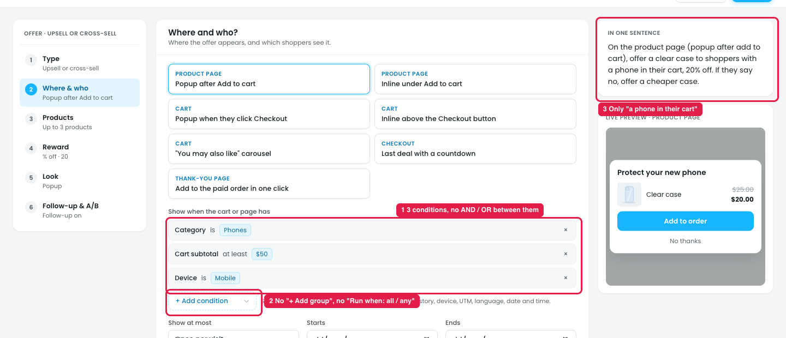

# Upsell and cross-sell: conditions have no AND / OR

In every Upsell and cross-sell template, the **Where & who** step lists conditions one under another, with no way to say if **all** of them must match or **any** of them. It applies to:

- Product page offer, Checkout last deal, Frequently bought together, Downsell after a no, Switch to subscription: **"Show when the cart or page has"**
- Thank-you page coupon: the same list, titled **"Extra conditions for the order"**

(Mix & Match box has no condition list.)

## Issue

**Steps:** Campaigns → Discounts → New discount → Product page offer → Where & who → + Add condition → Cart subtotal → + Add condition → Device

1. **Three conditions, nothing between them (marker 1):** Category is Phones, Cart subtotal at least $50, Device is Mobile. The owner can't tell if the offer shows when **all three** match (a phone, $50+ and mobile) or when **any one** matches (every mobile shopper).
2. **No way to choose or group (marker 2).** Next to "+ Add condition" there's no "Run when: all / any" and no "+ Add group". So "Phones **or** Tablets, **and** cart over $50" can't be built. The discount builder's Who & when step has both: "Run when" and "+ Add group".
3. **"In one sentence" shows only the first condition (marker 3):** "…to shoppers with a phone in their cart…". Cart subtotal and Device aren't in it, so the sentence doesn't confirm how the conditions combine either.

## Suggestion

- **Use the same condition block as the discount builder's Who & when step** in every upsell and cross-sell template:
  - With 2 or more conditions, show **Run when: [All of these ▾ / Any of these]** above the list.
  - Put a small **AND** or **OR** label between rows, so the logic can be read at a glance.
  - Add **+ Add group** for mixed logic: `Category is Phones OR Tablets` **AND** `Cart subtotal at least $50`.
- **"In one sentence" lists every condition with its joining word:** *"…to shoppers with a phone in their cart **and** a cart of $50 or more, **on mobile**…"*
