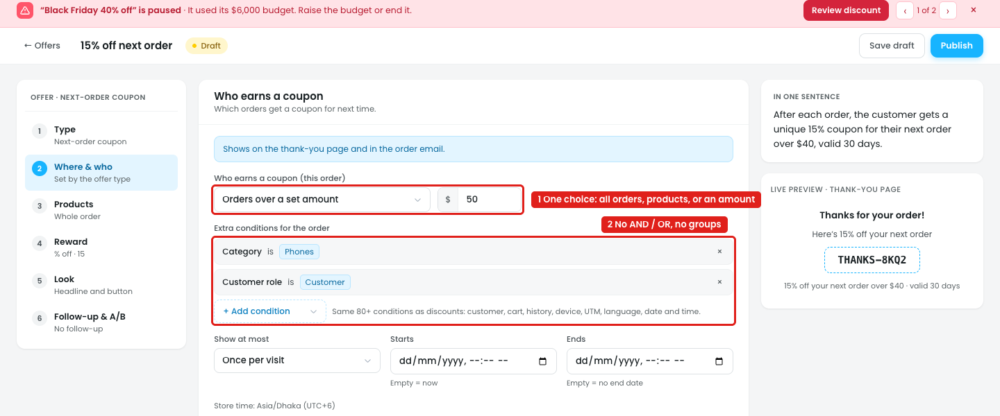
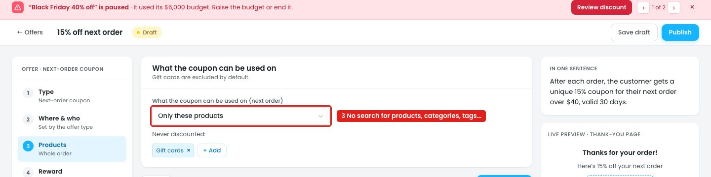

# Offers: Next-order coupon

After an order, the shopper gets a unique coupon for their next order, shown on the thank-you page and in the order email. The offer is opened from the After the order tab with "Edit in offer editor".

## Issue 1: Who earns a coupon is a single choice

**Steps:** Campaigns → Offers → After the order → Next-order coupon → Edit in offer editor → Where & who → Who earns a coupon (this order) → Orders over a set amount → + Add condition → Category → + Add condition → Customer role

1. **"Who earns a coupon" offers only one choice (marker 1):** All orders, Orders with these products or categories, or Orders over a set amount ($50). The owner can't combine them, e.g. "orders with a phone **and** over $50", or "Phones **or** Tablets".
2. **"Extra conditions for the order" has no AND / OR (marker 2).** Category is Phones and Customer role is Customer sit one under another, with no "Run when: all / any" and no "+ Add group". The owner can't tell whether both must match.

## Issue 2: "Only these products" has no product search

**Steps:** Campaigns → Offers → After the order → Next-order coupon → Edit in offer editor → Products → Only these products

3. **After picking "Only these products", nothing appears to pick them (marker 3).** There's no search for products, categories, tags, brands or SKUs, so the owner can't choose what the coupon works on. "All except" has the same problem.

## Suggestion

- **Replace the "Who earns a coupon" list with the discount builder's condition block:**
  - `Run when: [All of these ▾ / Any of these]`
  - Rows such as `Category is Phones`, `Cart subtotal at least $50`, `Customer role is Customer`, with an **AND** / **OR** label between them
  - **+ Add condition** and **+ Add group**, e.g. (`Category is Phones` OR `Category is Tablets`) AND `Cart subtotal at least $50`
  - Empty list = all orders earn a coupon
  - "In one sentence" lists every condition: *"After each order with a phone **and** a subtotal of $50 or more, the customer gets…"*
- **Products → Only these products / All except:** show a product picker with one search box for products, categories, tags, brands and SKUs. Show each pick as a chip with an ×, e.g. `[Candles ×] [Fig candle ×]`, and show the match count: *"38 products match"*.
