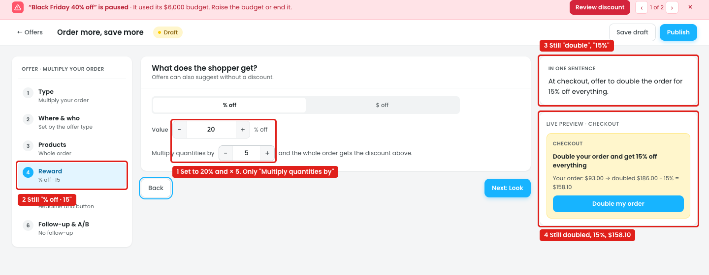
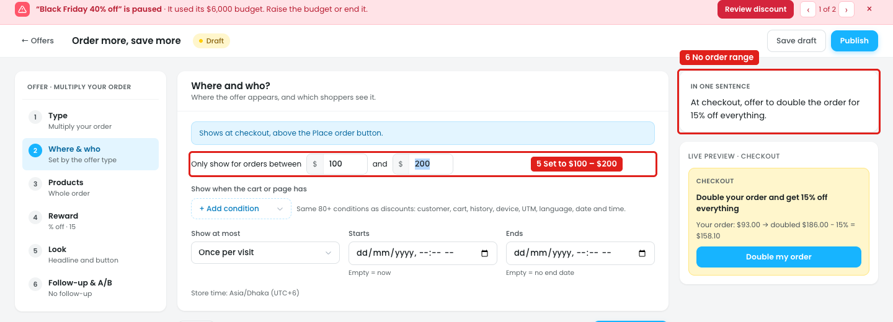
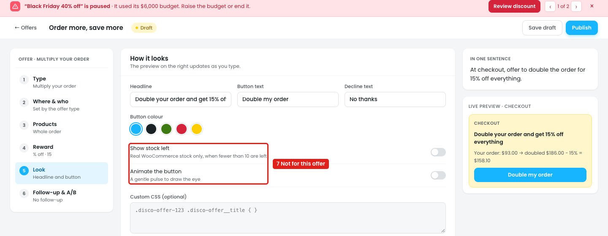
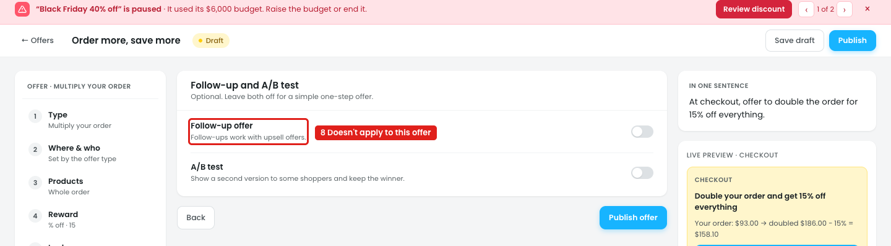

# Offers: New offer → Multiply your order

At checkout, the shopper sees *"Double your order and get 15% off everything"*. One click on **Double my order** multiplies the quantities in the cart, and the whole order gets the discount: $93.00 → $186.00 doubled, the shopper pays $158.10.

## Issue 1: Reward

**Steps:** Campaigns → Offers → New offer → Multiply your order → Reward → Value 20 → Multiply quantities by 5

1. **The only setting is "Multiply quantities by" (marker 1).**
   - There's no choice of what "more" means. "Add 1 more of each item" and "Reach a total" exist only on the Order more, save more card in Offers → After the order, not in the builder.
   - Nothing says what happens when an item doesn't have enough stock.
   - × 5 is accepted with no limit or warning, so a cart of 4 items can become 20.
2. **The side summary still says "% off · 15" (marker 2).**
3. **"In one sentence" still says "double the order for 15% off" (marker 3).**
4. **The preview still says doubled, 15%, $158.10 (marker 4).** With 20% and × 5 it should be $93.00 → $465.00, and the shopper pays $372.00.

## Issue 2: Where & who

**Steps:** Campaigns → Offers → New offer → Multiply your order → Where & who → Only show for orders between $100 and $200

5. **The offer is limited to orders of $100–$200 (marker 5).**
6. **"In one sentence" doesn't mention it (marker 6).**

## Issue 3: Settings that don't apply

**Steps:** Campaigns → Offers → New offer → Multiply your order → Look

7. **"Show stock left" and "Animate the button" (marker 7)** are for single-product offers.

**Steps:** Campaigns → Offers → New offer → Multiply your order → Follow-up & A/B

8. **"Follow-up offer" says "Follow-ups work with upsell offers" (marker 8).** It can't be used here, but it's still shown.

## Suggestion

- **Add the missing settings to Reward:**
  - **What "more" means:** `Multiply every item by [2]` / `Add [1] more of each item` / `Reach a total of $[150]`
  - **If an item doesn't have enough stock:** `Skip that item` / `Hide the offer`
  - Limit the multiplier, e.g. 2–3, and show *"Max 3"* when a bigger number is typed.
- **Build the side summary, "In one sentence", headline and preview from the values:**
  - *"At checkout, offer to triple the order for 20% off everything, for orders between $100 and $200."*
  - Preview: *"Your order: $93.00 → tripled $279.00 − 20% = $223.20"*
- **Look:** hide "Show stock left" and "Animate the button" for this offer type.
- **Follow-up & A/B:** hide Follow-up for this offer type, and keep A/B test only.
