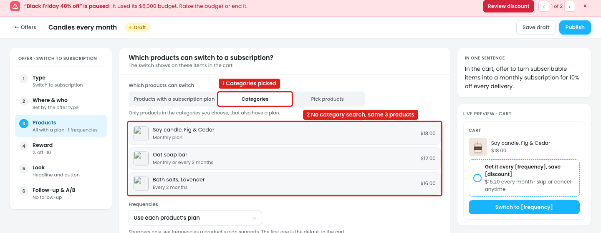
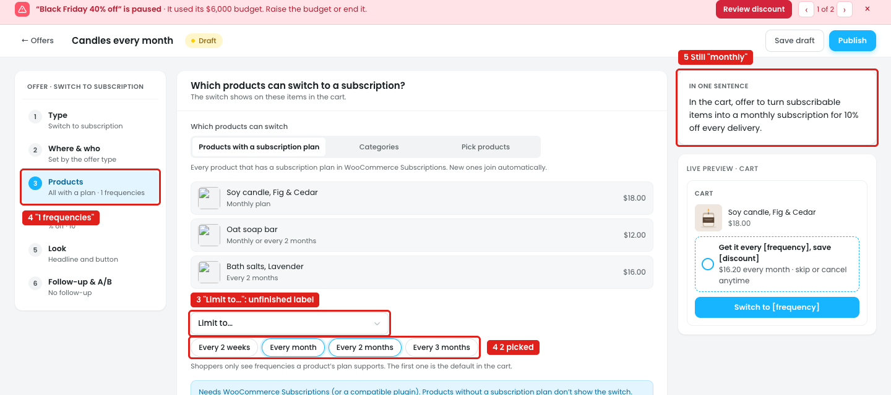
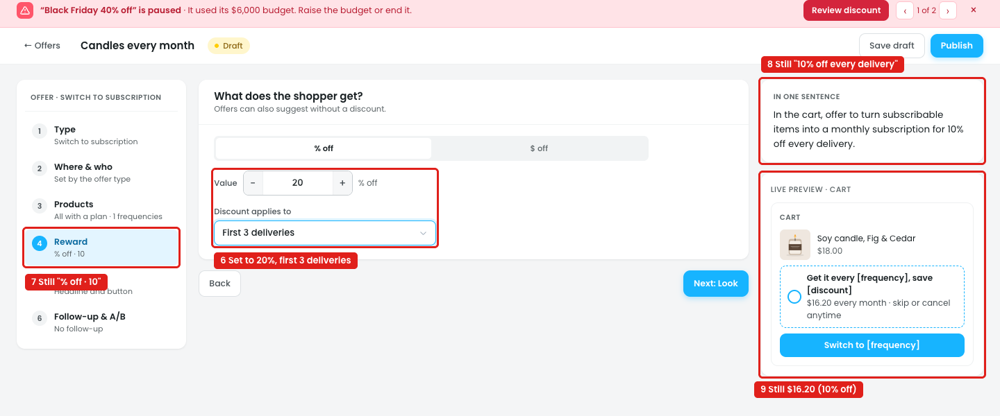
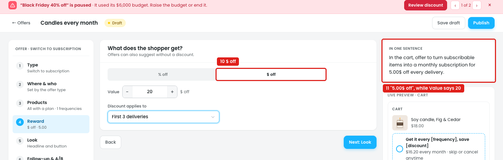
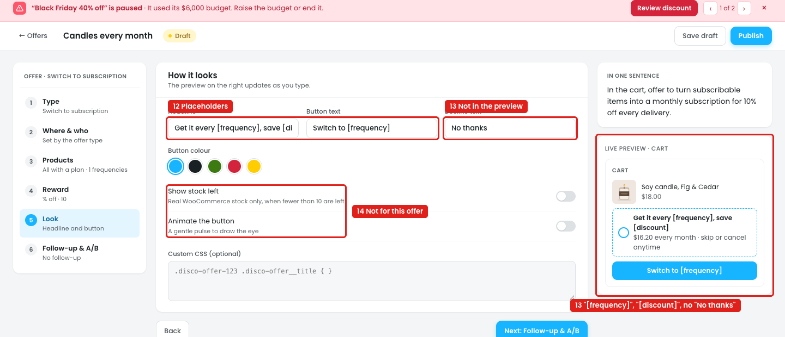
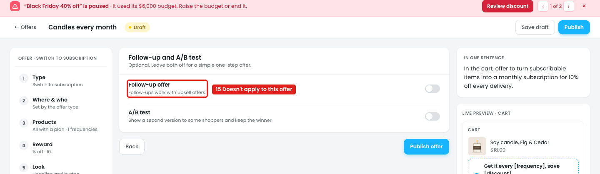

# Offers: New offer → Switch to subscription

In the cart, an item that has a subscription plan gets a box like *"Get it every month, save 10%"* with a **Switch to monthly** button. One click turns that item into a subscription, and the deliveries get the discount. This needs WooCommerce Subscriptions.

## Issue 1: Categories has no category picker

**Steps:** Campaigns → Offers → New offer → Switch to subscription → Products → Categories

1. **"Categories" is picked (marker 1).** The help text says *"Only products in the categories you choose"*, but there's nothing to choose them with. "Pick products" is the same: no product search.
2. **The list doesn't change (marker 2).** It shows the same 3 products with a plan whichever tab is picked.

## Issue 2: Frequencies

**Steps:** Campaigns → Offers → New offer → Switch to subscription → Products → Frequencies → Limit to…

3. **"Limit to…" (marker 3)** reads like an unfinished label.
4. **Two frequencies are picked, "Every month" and "Every 2 months" (marker 4),** but the step summary says **"1 frequencies"**: the count is wrong, and so is the plural.
5. **"In one sentence" still says "a monthly subscription" (marker 5).** It doesn't follow the frequencies.

## Issue 3: Reward changes don't reach the sentence or preview

**Steps:** Campaigns → Offers → New offer → Switch to subscription → Reward → Value 20 → Discount applies to → First 3 deliveries

6. **Set to 20% off the first 3 deliveries (marker 6).** The other choices in "Discount applies to" are "Every delivery" and "First order only". For a subscription, "First order only" is unclear: it most likely means the first delivery.
7. **The step summary still says "% off · 10" (marker 7).**
8. **"In one sentence" still says "10% off every delivery" (marker 8).**
9. **The preview still shows $16.20 every month, which is 10% off $18.00 (marker 9).** With 20% it should be $14.40, and only for the first 3 deliveries.

**Steps:** Campaigns → Offers → New offer → Switch to subscription → Reward → Value 20 → Discount applies to → First 3 deliveries → $ off

10. **$ off is picked (marker 10),** and Value still shows 20.
11. **"In one sentence" says "5.00$ off every delivery" (marker 11).** The amount is 5.00, not the 20 in Value, the $ sign is after the number, and "first 3 deliveries" is missing.

## Issue 4: The preview shows placeholders

**Steps:** Campaigns → Offers → New offer → Switch to subscription → Look

12. **The headline and button use placeholders (marker 12):** "Get it every [frequency], save [discount]" and "Switch to [frequency]".
13. **The preview shows them as they are (marker 13):** *"Get it every [frequency], save [discount]"*, *"Switch to [frequency]"*. The line under it is filled in ("$16.20 every month"), so the owner can't see what the shopper will read. "Decline text: No thanks" isn't in the preview at all.
14. **"Show stock left" and "Animate the button" (marker 14)** are for single-product offers.

## Issue 5: Follow-up doesn't apply

**Steps:** Campaigns → Offers → New offer → Switch to subscription → Follow-up & A/B

15. **"Follow-up offer" says "Follow-ups work with upsell offers" (marker 15).** It can't be used here, but it's still shown.

## Suggestion

- **Fill in the placeholders in the preview** from Reward and Frequencies: *"Get it every month, save 20%"* / *"Switch to monthly"*. Show the decline link under the button.
- **Products:**
  - **Categories:** a category search with chips, e.g. `[Candles ×]`.
  - **Pick products:** a product search.
  - Update the list to show only the matching products, with a count: *"2 products with a plan"*.
- **Frequencies:** label the option **"Only these frequencies"**. The summary counts the picks with the right plural: "1 frequency" / "2 frequencies".
- **Reward:**
  - Rename "First order only" to **"First delivery only"**.
  - Keep Value when switching between % off and $ off, or clear it, but never show a different amount in the sentence.
- **Build the summary, "In one sentence" and preview from the values:** *"In the cart, offer to turn subscribable items into a subscription (every month or every 2 months) for 20% off the first 3 deliveries."* Write money as **$5.00 off**.
- **Look:** hide "Show stock left" and "Animate the button" for this offer type.
- **Follow-up & A/B:** hide Follow-up for this offer type, and keep A/B test only.
