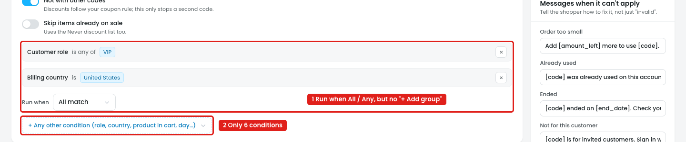
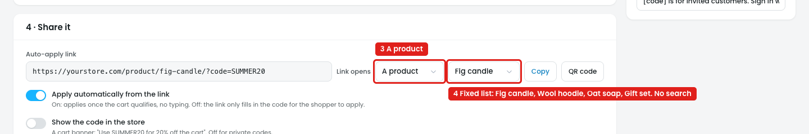

# Coupons → New code: few conditions, and a fixed product list for the link

## Issue 1: "+ Any other condition" has only 6 conditions and no groups

**Steps:** Campaigns → Coupons → New code → 3 · Who and how often → + Any other condition → Customer role → + Any other condition → Billing country

1. **"Run when: All match / Any matches" applies to the whole list, and there's no "+ Add group" (marker 1).** So a coupon for "VIP **or** Wholesale customers, **and** only in the United States" can't be built.
2. **The list has only 6 conditions (marker 2):** Required in cart: product, Cart quantity, Customer role, Billing country, Number of orders, Day of week. The label promises "role, country, product in cart, day…", but the condition picker in a discount's Who & when step has about 80 (cart, customer, purchase history, checkout address, traffic, date and time, plugins). Conditions such as "UTM campaign", "Device" or "Cart subtotal" can't be used on a coupon.

## Issue 2: "Link opens → A product" picks from a fixed list

**Steps:** Campaigns → Coupons → New code → 4 · Share it → Link opens → A product

3. **"A product" is picked (marker 3),** and the link becomes `yourstore.com/product/fig-candle/?code=SUMMER20`.
4. **The product is chosen from a fixed dropdown of 4 (marker 4):** Fig candle, Wool hoodie, Oat soap, Gift set. A store with hundreds of products can't search for the page it wants.

## Suggestion

- **Conditions:** open the same condition picker as a discount's Who & when step (search box, all condition groups), and add **+ Add group**, e.g.
  `Customer role is VIP` **OR** `Customer role is Wholesale` → group **AND** `Billing country is United States`.
- **Link opens → A product:** replace the dropdown with a product search, e.g. `[🔍 Search products…]` → *Fig candle · $18.00*, and show the picked product as a chip.
