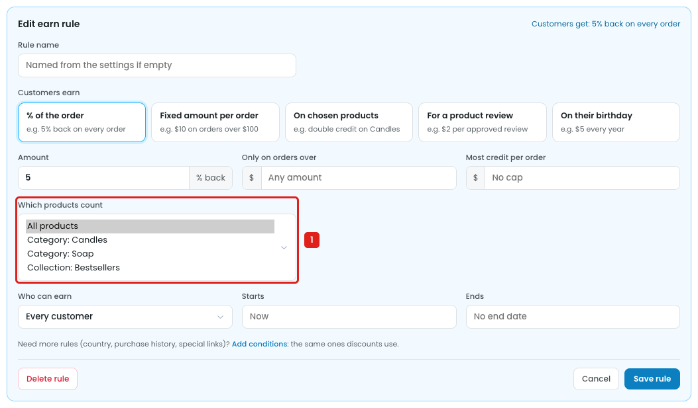
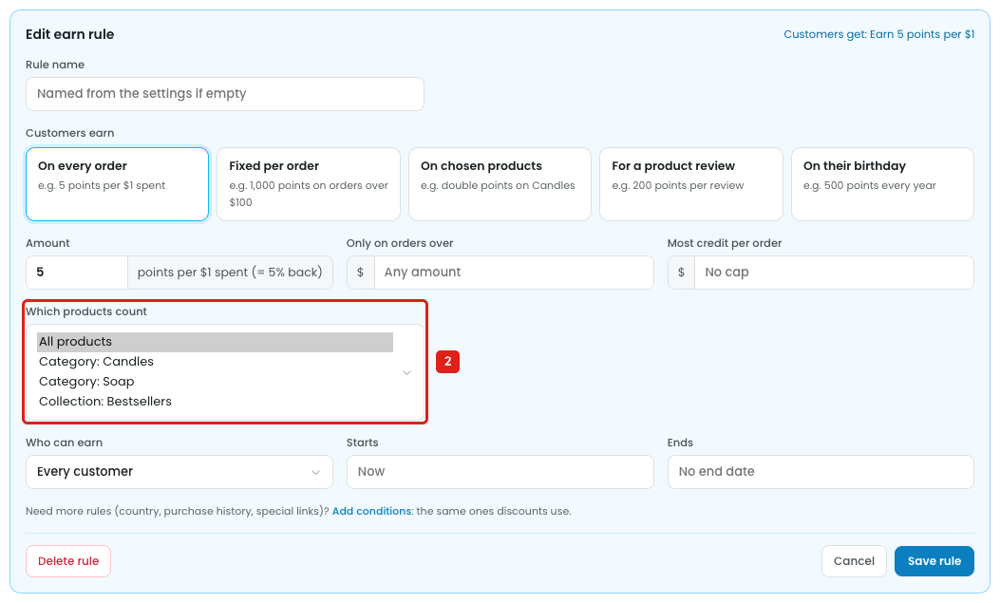
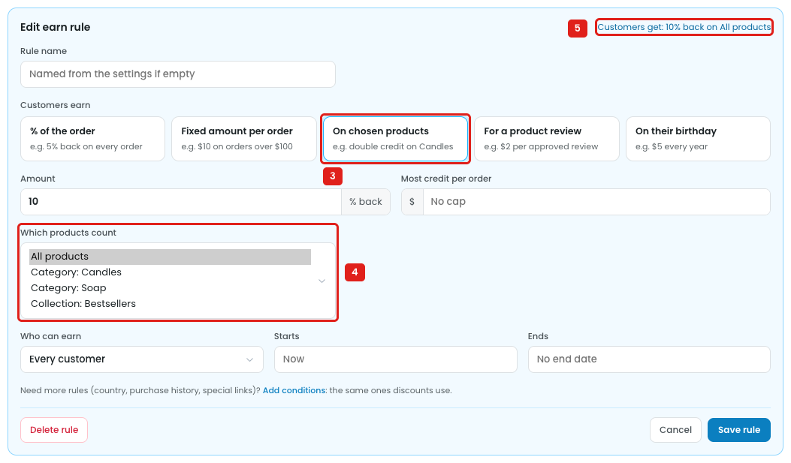
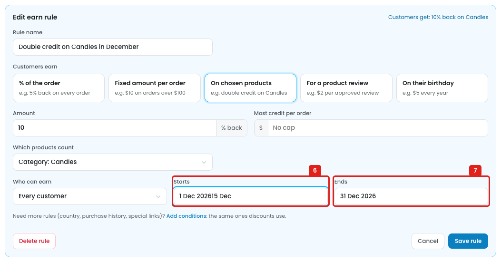

# Store credit: earn rule products have no search, and dates have no calendar

This applies to both ways customers see their credit: **Money ($)** and **Points**.

## Issue 1: "Which products count" is a fixed list

### Money ($)

**Steps:** Campaigns → Credits → Store credit → How customers earn credit → 5% back on every order → Edit → Which products count

1. **"Which products count" is a dropdown with 4 fixed options (marker 1):** All products, Category: Candles, Category: Soap, Collection: Bestsellers.
   - There's no search, so a store with many products and categories can't find the one it wants.
   - Only one option can be picked: "Candles **and** Soap" can't be set.
   - A single product, a tag, a brand or a SKU can't be picked.
   - There's no way to leave products out, e.g. "all products except gift cards".

### Points

**Steps:** Campaigns → Credits → Store credit → How customers see their credit → Points → How customers earn credit → Earn 5 points per $1 → Edit → Which products count

2. **The Points earn rule has the same 4-option dropdown (marker 2),** with the same limits.

## Issue 2: "On chosen products" uses the same list

**Steps:** Campaigns → Credits → Store credit → How customers earn credit → 5% back on every order → Edit → Customers earn → On chosen products → Which products count

3. **"On chosen products" is picked (marker 3).** This rule type exists to give credit on specific products, e.g. "double credit on Candles".
4. **The product choice is the same 4-option dropdown (marker 4),** and it starts on "All products".
5. **The summary says "Customers get: 10% back on All products" (marker 5).** So an "On chosen products" rule can be saved for all products.

## Issue 3: Starts and Ends don't open a calendar

**Steps:** Campaigns → Credits → Store credit → How customers earn credit → Double credit on Candles in December → Edit → Starts → type "15 Dec"

6. **Starts is a plain text box (marker 6).** Clicking it opens no calendar, and the date is typed by hand. Typing "15 Dec" after "1 Dec 2026" gives **"1 Dec 202615 Dec"**, with no error.
7. **Ends is the same (marker 7).** There's no time of day and no time zone, so the owner can't tell when on 31 Dec the rule stops. The same fields are used in Points mode.

## Suggestion

For both Money and Points:

- **Replace the dropdown with the product picker used elsewhere:**
  - One search box for products, categories, tags, brands and SKUs, e.g. `[🔍 Search products, categories, tags…]`.
  - **Only these** / **All except**.
  - Each pick as a chip with an ×, e.g. `[Candles ×] [Soap ×] [Fig candle ×]`, and a match count: *"38 products match"*.
- **On chosen products:** start with an empty picker, and ask for at least one product before the rule can be saved: *"Pick at least one product"*.
- **Build the summary from the picks:** *"Customers get: 10% back on Candles and Soap"*.
- **Starts / Ends:**
  - Open a calendar on click, e.g. `[📅 1 Dec 2026]`.
  - Add an optional time (Starts 00:00, Ends 23:59) and show the store time zone, e.g. *"Times in America/New_York"*.
  - Keep "Now" and "No end date" as one-click choices.
  - Don't allow an end date before the start date.
