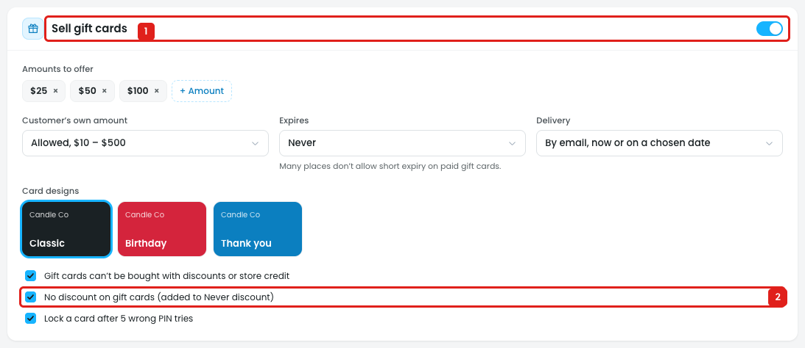
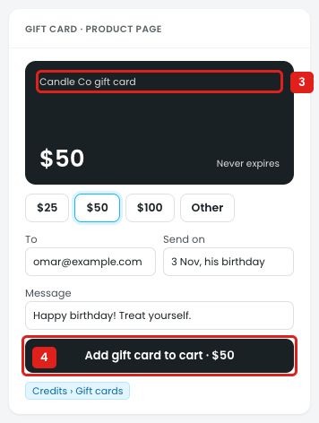

# Gift cards: the gift card product isn't shown in the settings

In the store, a gift card is sold as a product: it has its own product page, is added to the cart and is paid for at checkout. The Gift cards settings don't say which product that is.

## Issue 1: No product name, URL or link in the settings

**Steps:** Campaigns → Credits → Gift cards → Sell gift cards

1. **"Sell gift cards" is on (marker 1),** but the section has no product name, URL or image, and no "View product" or "Edit in WooCommerce" link. The owner can't tell:
   - whether turning it on creates a gift card product, or uses one that already exists
   - what the product is called and where it is in the store
   - where to change its image, description, category or SEO
2. **"No discount on gift cards (added to Never discount)" (marker 2)** adds the gift card to the Never discount product list, so it is treated as a product, but the product itself is never shown.

## Issue 2: The store sells it as a product named "Candle Co gift card"

**Steps:** Campaigns → Credits → Gift cards → Preview in store → Credits

3. **The product page shows "Candle Co gift card" (marker 3).** This name isn't set anywhere in the Gift cards settings.
4. **"Add gift card to cart · $50" (marker 4)** adds it to the cart like any product, but the settings don't link to that product page.

## Suggestion

Add a **Gift card product** block at the top of the Sell gift cards section, like the Box product name and URL on the Mix & Match box:

- **Product:** `(•) Create a new gift card product` / `( ) Use an existing product [🔍 Search products…]`
- **Product name:** `[Candle Co gift card]`
- **URL:** `yourstore.com/product/gift-card/` with **View product ↗** and **Edit in WooCommerce ↗** (image, description, category, SEO)
- Show its status: *"Published · in Gift cards category"*, or *"Draft: not visible in the store"* with a **Publish** button.
- When "Sell gift cards" is turned off, say what happens to the product: *"The gift card product will be hidden. Cards already sold still work."*
