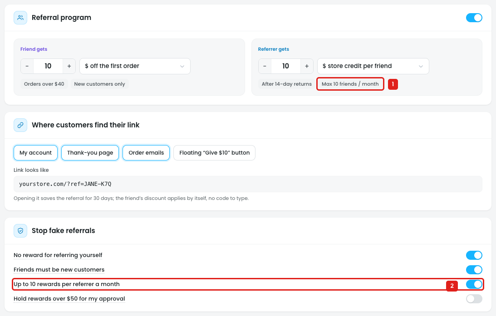
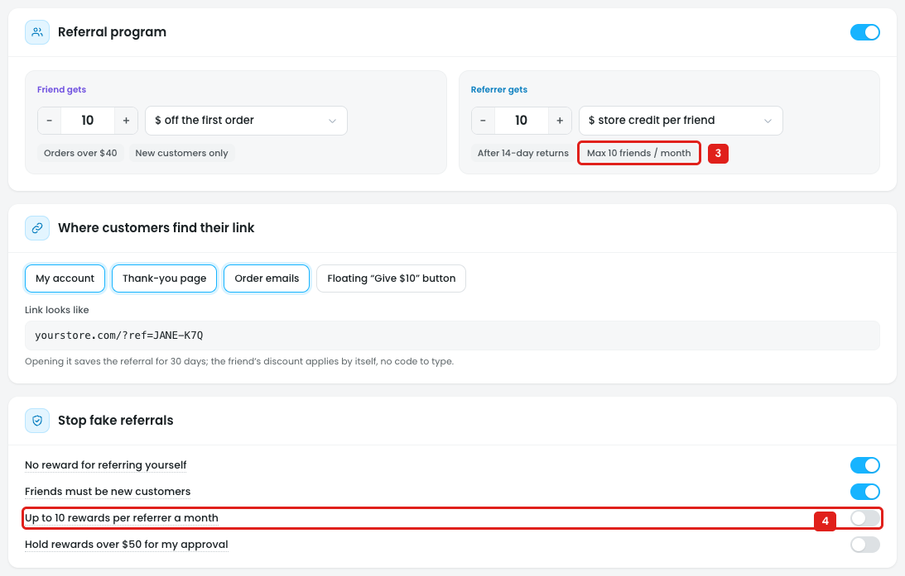

# Referrals: the friend limit is fixed at 10

## Issue 1: "Max 10 friends / month" can't be changed

**Steps:** Campaigns → Credits → Referrals

1. **"Referrer gets" shows "Max 10 friends / month" (marker 1).** It's a label, not a field: the number 10 can't be edited.
2. **"Up to 10 rewards per referrer a month" (marker 2)** is an on/off switch only. There's no field for the number, so the owner can't set, for example, 5 or 20 friends a month, or pick a different period (week, year, all time).

## Issue 2: The label stays when the limit is off

**Steps:** Campaigns → Credits → Referrals → Stop fake referrals → Up to 10 rewards per referrer a month → off

3. **"Max 10 friends / month" is still shown under "Referrer gets" (marker 3),**
4. **while "Up to 10 rewards per referrer a month" is switched off (marker 4).** The owner can't tell if the limit still applies.

## Suggestion

- **Make the limit a setting** in Stop fake referrals:
  `[✓] Limit rewards per referrer: up to [10] friends per [month ▾]` (week / month / year / all time)
- **Build the "Referrer gets" label from it:** *"Max 20 friends / month"*, or *"No limit"* when the switch is off.
