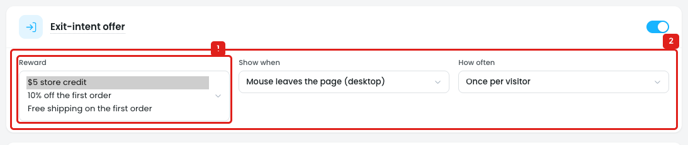
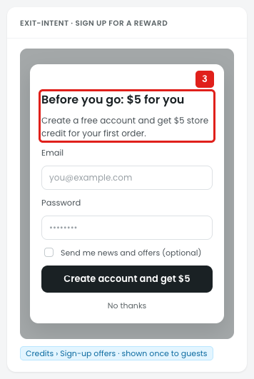
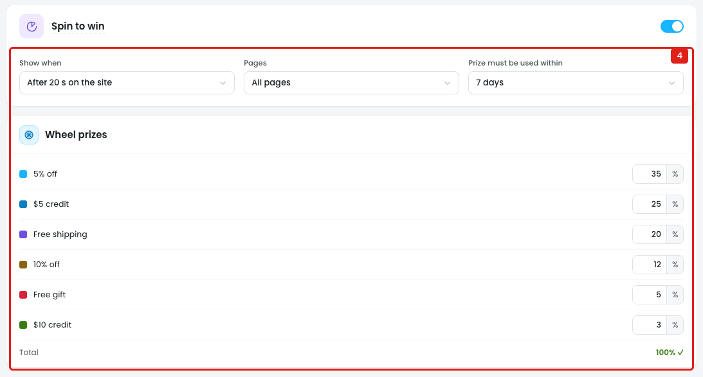
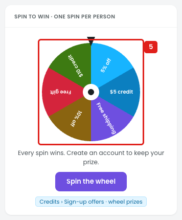
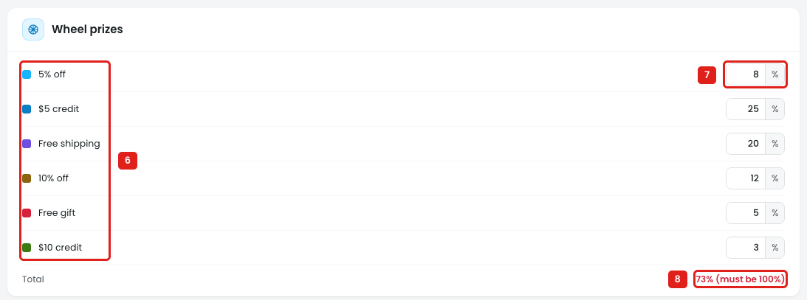

# Sign-up offers: fixed rewards and prizes, and no design preview

## Issue 1: Reward has only 3 fixed options

**Steps:** Campaigns → Credits → Sign-up offers → Exit-intent offer → Reward

1. **"Reward" offers only $5 store credit, 10% off the first order, or Free shipping on the first order (marker 1).** The owner can't:
   - set the amount, e.g. $10 credit or 15% off
   - pick $ off or a free gift
   - set a minimum order, e.g. "on orders over $40"
   - set when the credit or discount expires, e.g. "use within 14 days"
   - choose which products the discount works on

## Issue 2: The settings don't show what the customer sees

**Steps:** Campaigns → Credits → Sign-up offers → Exit-intent offer

2. **The section has only 3 dropdowns: Reward, Show when, How often (marker 2).** There's no:
   - preview of the popup, or link to one
   - headline, text, button or "No thanks" text to edit
   - image or colors
   - Pages setting (which pages the popup can show on)

**Steps:** Campaigns → Credits → Sign-up offers → Preview in store → Credits

3. **The popup is only shown in the store preview (marker 3):** *"Before you go: $5 for you. Create a free account and get $5 store credit for your first order."* The owner has to find it there, and can't change the text.

## Issue 3: Spin to win has no design preview

**Steps:** Campaigns → Credits → Sign-up offers → Spin to win → on

4. **Spin to win shows only Show when, Pages, Prize must be used within and the Wheel prizes list (marker 4).** There's no preview of the wheel or popup, and nothing to set its look: wheel colors, headline ("Every spin wins…"), button text ("Spin the wheel"), the screen that shows the prize, or the sign-up form after the spin.

**Steps:** Campaigns → Credits → Sign-up offers → Preview in store → Credits

5. **The wheel is only shown in the store preview (marker 5),** so the owner can't see how the prizes and colors look while setting them.

## Issue 4: Wheel prizes can't be changed, and the wheel doesn't follow the chances

**Steps:** Campaigns → Credits → Sign-up offers → Spin to win → on → Wheel prizes → 5% off → 8

6. **The 6 prizes are fixed labels (marker 6):** 5% off, $5 credit, Free shipping, 10% off, Free gift, $10 credit. The owner can't:
   - change the value, e.g. 5% → 15% off, or $5 → $20 credit
   - add or remove a prize
   - pick which product is the Free gift
   - set a minimum order for a prize, or change its label or color
7. **Only the chance (%) can be changed (marker 7).** Each % is how often the wheel stops on that prize. 5% off is changed from 35 to 8.
8. **The total shows "73% (must be 100%)" (marker 8)** but doesn't say how to fix it: which prize to raise, or a way to balance the rest. There's no Save button, so it isn't clear whether a total under 100% is kept.

The wheel in the store preview (marker 5, Issue 3) is drawn with **6 equal slices**, whatever the chances are: "5% off" at 35% and "$10 credit" at 3% take the same space. The owner can't see the real odds, and shoppers aren't shown them anywhere.

## Suggestion

- **Reward:**
  - Type: `$ store credit` / `% off` / `$ off` / `Free shipping` / `Free gift [🔍 Search products…]`
  - Amount: `[10]`
  - `Only on orders over $[40]`
  - `Use within [14] days`
  - Which products count: the product picker (search products, categories, tags, brands, SKUs).
- **Look:** headline, text, button and decline text, filled in from the reward and editable, e.g. `Before you go: [10% off] for you`. Add an image and colors.
- **Pages:** All pages / Shop and product pages / Cart and checkout / Home page only.
- **Show a live popup preview** next to the settings, updated as the reward and text change, with a **Preview in store ↗** link.
- **Spin to win:** add a **Look** part (wheel colors, headline, button text, prize message), and a live preview next to Wheel prizes that shows the wheel, the "You won 10% off" screen and the sign-up form, updated as prizes change.
- **Wheel prizes:**
  - An editable row per prize: `[● color] [Type ▾ % off / $ off / $ credit / Free shipping / Free gift] [Value 15] [Min order $—] [Chance 12 %] [×]`
  - **+ Add prize** (e.g. 4–12 prizes). For Free gift: `[🔍 Search products…]`
  - Total helper: *"73%: add 27% to reach 100%"*, with a **Balance** button, and no saving until the total is 100%.
  - Build the wheel from the prizes (labels and colors), and show the odds to shoppers, e.g. a **Prize odds** link under the wheel.
