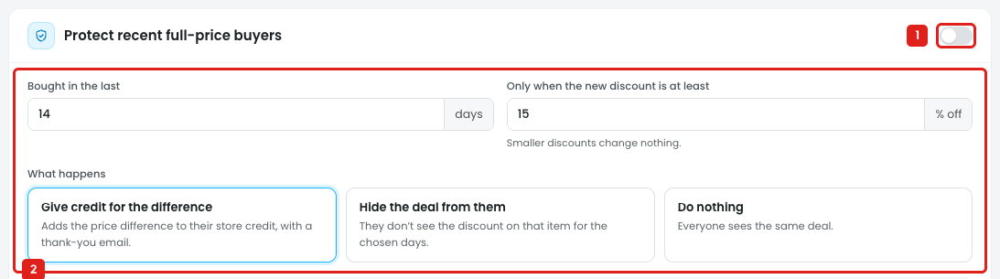
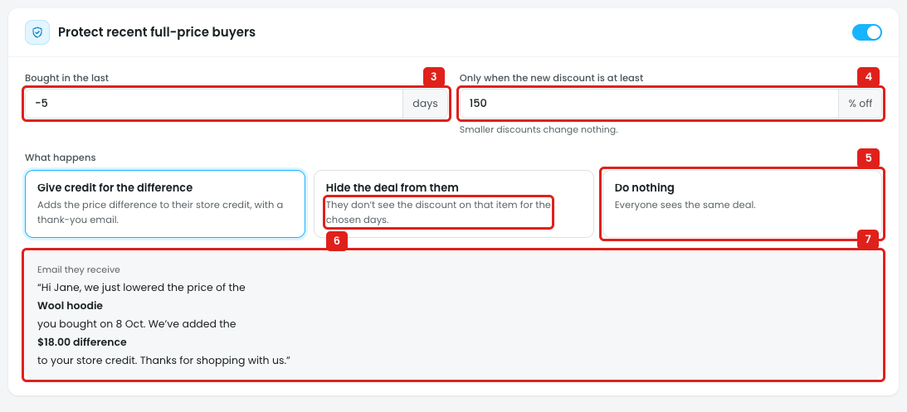
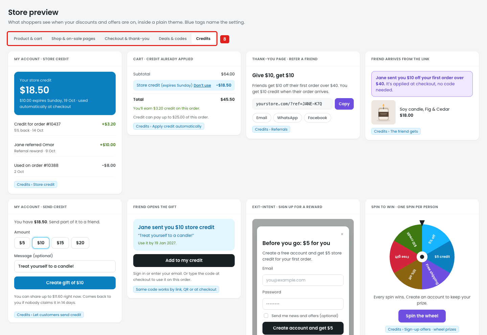

# Credits: Price protection

Price protection looks after customers who paid full price just before a sale. If they bought within the set days and the new discount is big enough, they get the difference as store credit, or the deal is hidden from them.

## Issue 1: Turning protection off changes nothing on the page

**Steps:** Campaigns → Credits → Price protection → Protect recent full-price buyers → off

1. **"Protect recent full-price buyers" is off (marker 1).**
2. **The settings below stay active (marker 2):** Bought in the last, Only when the new discount is at least, and What happens can still be edited, and nothing is dimmed or hidden. The owner can't tell at a glance whether protection is running.

## Issue 2: Wrong values, an unclear option, and a fixed email

**Steps:** Campaigns → Credits → Price protection → Bought in the last -5 → Only when the new discount is at least 150

3. **"Bought in the last" accepts -5 days (marker 3),** with no error.
4. **"Only when the new discount is at least" accepts 150% off (marker 4),** with no error.
5. **"Do nothing" (marker 5)** has the same result as switching protection off. Protection can be "on" and still do nothing, which is confusing.
6. **"Hide the deal from them… for the chosen days" (marker 6)** points to a setting that doesn't exist. Nothing sets how long the deal is hidden. It may mean the "Bought in the last" days, but the page doesn't say.
7. **"Email they receive" is a fixed sample (marker 7).** The owner can't edit the subject or text, turn the email off, or preview it with their own values. It always shows Wool hoodie, 8 Oct, $18.00.

## Issue 3: Settings that are missing

**Steps:** Campaigns → Credits → Price protection

The section in the screenshot above (markers 3–7) is everything there is. It doesn't say:

- **Which products are protected:** all products, some categories, or exclusions such as gift cards or items already on sale.
- **Which price drops count:** Disco discounts only, or also WooCommerce sale prices, coupons and member prices.
- **A limit on credit:** no maximum per customer, per order or per month, so a big sale on expensive items can give a lot of credit.
- **Timing and refunds:** whether the credit waits for the return window, and what happens to it if the original order is refunded.
- **Quantity:** whether buying 3 of an item gives 3 × the difference.

## Issue 4: Not shown in the store preview

**Steps:** Campaigns → Credits → Price protection → Preview in store → Credits

8. **None of the store preview tabs show price protection (marker 8).** Product & cart, Shop & on-sale pages, Checkout & thank-you, Deals & codes and Credits have no price-drop email, credit line or "price dropped" message, so the owner can't see what the customer gets.

## Suggestion

- **Switch:** when off, dim or hide the settings and show *"Price protection is off"*. Remove **Do nothing**, because the switch already does that.
- **Limits:** Bought in the last `[14]` days (1–90), discount at least `[15]` % (1–90). Show an error for values out of range.
- **Hide the deal:** add `Hide the deal for [14] days`.
- **Products:** `All products` / `Only these` / `All except` with the product picker (products, categories, tags, brands, SKUs). Exclude gift cards by default.
- **Price drops that count:** `[✓] Disco discounts  [✓] Sale prices  [ ] Coupons`
- **Cap:** `Max credit per customer $[50] per [month ▾]`
- **Timing:** `Give credit after the return window`, and `Take credit back if the order is refunded`.
- **Quantity:** `Credit the difference for each item bought`.
- **Email:** an editable subject and text with `[product]`, `[date]`, `[amount]`, an on/off switch, and a live preview. Add a **Price protection** card to the store preview's Credits tab.
