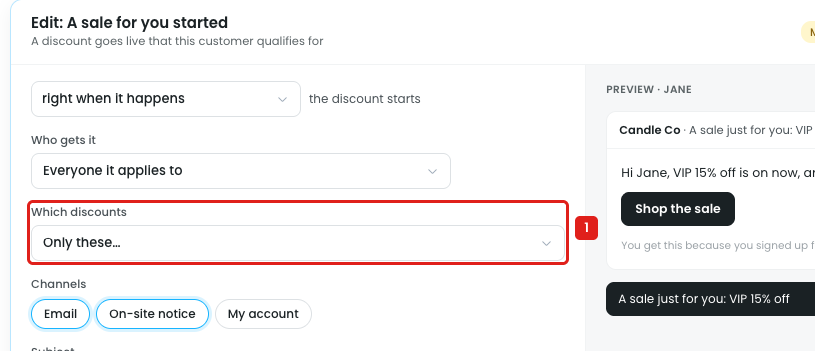
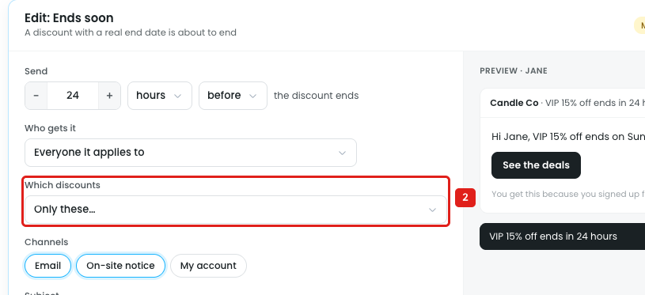
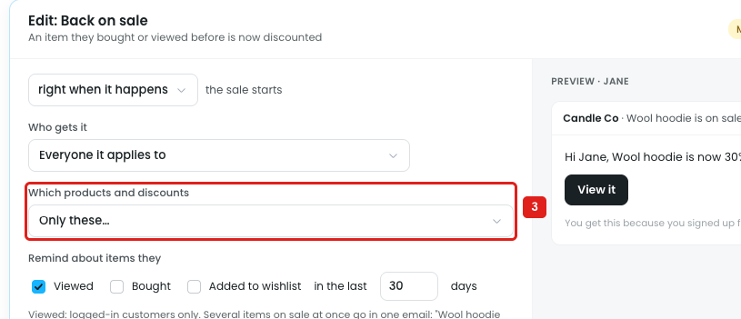

# Reminders: "Which discounts → Only these…" has nothing to pick

The three discount reminders (A sale for you started, Ends soon, Back on sale) have a **Which discounts** setting: **All discounts** or **Only these…**. When "Only these…" is picked, no list or search appears, so the reminder always runs for every discount.

## Issue

**Steps:** Reminders → Discounts → A sale for you started → Edit → Which discounts → Only these…

1. **"Only these…" is picked (marker 1),** and nothing appears under it: no discount list, search or checkboxes. The next setting, Channels, follows straight after.

**Steps:** Reminders → Discounts → Ends soon → Edit → Which discounts → Only these…

2. **Ends soon is the same (marker 2).**

**Steps:** Reminders → Discounts → Back on sale → Edit → Which products and discounts → Only these…

3. **Back on sale is the same (marker 3):** no discount can be picked. (Choosing products for Back on sale is in note 22.)

Why it matters:

- **Too many emails.** A store with 10 live discounts sends "A sale for you started" for each one; only the weekly cap stops it. "Ends soon" fires for every discount with an end date.
- **Not every discount should be announced.** Small or always-on rules (wholesale pricing, "Buy 2, save 5%") aren't news. Private deals (a VIP code, an affiliate link) shouldn't be sent to everyone it applies to.
- **One text for all.** The subject and message are shared, so a big event like Black Friday can't get its own reminder and wording.
- **The option looks set but isn't.** The owner picks "Only these…", saves, and still sends reminders for every discount.

## Suggestion

- **When "Only these…" is picked, show a discount picker:**
  - Search with chips: `[🔍 Search discounts…]` → `[Black Friday 40% off ×] [VIP 15% off ×]`
  - Show each discount's status and dates, e.g. *"Scheduled · 28 Nov – 2 Dec"*.
  - Add **All except…** for the reverse.
- **Back on sale:** a separate **Which discounts** setting with the same discount picker (products: see note 22).
- **Allow more than one reminder of the same type,** e.g. a "Black Friday started" reminder with its own text, next to the general one.
- **In the discount builder,** add a **Remind customers** switch, so the choice can be made from the discount too.
- **Show the scope in the reminder list:** *"A sale for you started · 2 discounts"*.
