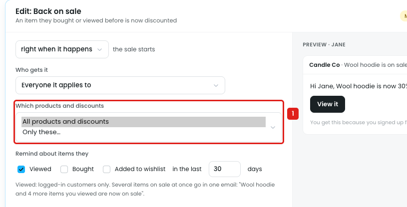
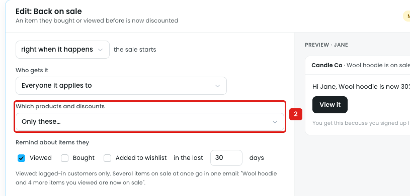

# Reminders → Back on sale: products can't be chosen

"Back on sale" emails a customer when an item they viewed, bought or added to their wishlist gets a discount. The owner can't choose which products this applies to.

## Issue 1: Products and discounts share one dropdown

**Steps:** Reminders → Discounts → Back on sale → Edit → Which products and discounts

1. **"Which products and discounts" has only 2 options (marker 1):** All products and discounts, or Only these…
   - Products and discounts are mixed in one setting, so the owner can't choose products on their own.
   - There's no way to leave products out, e.g. every product except gift cards, or items already on clearance.

## Issue 2: "Only these…" has no product picker

**Steps:** Reminders → Discounts → Back on sale → Edit → Which products and discounts → Only these…

2. **"Only these…" is picked (marker 2),** and nothing appears to pick products with: no search, no list. The next setting, "Remind about items they", follows straight after. So the reminder still runs for every product.

## Suggestion

Give Back on sale its own **Which products** setting:

- `(•) All products`
- `( ) Only these products`
- `( ) All except these products`

The last two open the product picker: one search box for products, categories, tags, brands and SKUs, with each pick shown as a chip and a match count, e.g.

- Only these: `[Candles ×] [Wool hoodie ×]` · *"24 products"*
- All except: `[Gift cards ×] [Clearance ×]` · *"312 products"*

Keep the discount choice as a separate **Which discounts** setting.
