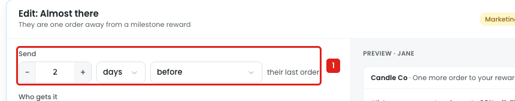
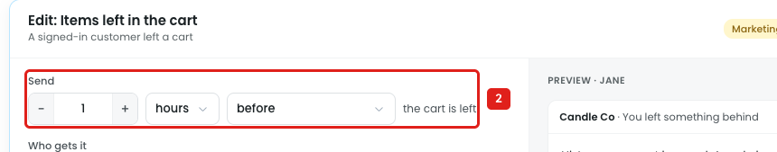

# Reminders: "before" is offered for events that have already happened

"Almost there" is sent after a customer's order leaves them one order away from a milestone reward. "Items left in the cart" is sent after a signed-in customer leaves a cart. Both are triggered by something that has already happened, but the Send dropdown still offers **before**.

## Issue 1: Almost there

**Steps:** Reminders → Cart and progress → Almost there → Edit → Send → before

1. **"Send 2 days before their last order" can be picked (marker 1).** The last order has already happened, so there's no "before" to send at. Picking it shows no warning, and the preview doesn't change.

## Issue 2: Items left in the cart

**Steps:** Reminders → Cart and progress → Items left in the cart → Edit → Send → before

2. **"Send 1 hour before the cart is left" can be picked (marker 2).** Disco can't know a cart will be left before it happens. Also, nothing says when a cart counts as "left", so "right when it happens" has no clear moment either.

## Suggestion

- **For these two reminders, offer only:** `after` / `right when it happens`.
  - Almost there: `Send [2] [days] [after ▾] their last order`
  - Items left in the cart: `Send [1] [hours] [after ▾] the cart is left`
- **Hide the number and unit** when "right when it happens" is picked.
- **Items left in the cart:** say when a cart counts as left, e.g. *"A cart counts as left after [30] minutes with no activity."*
