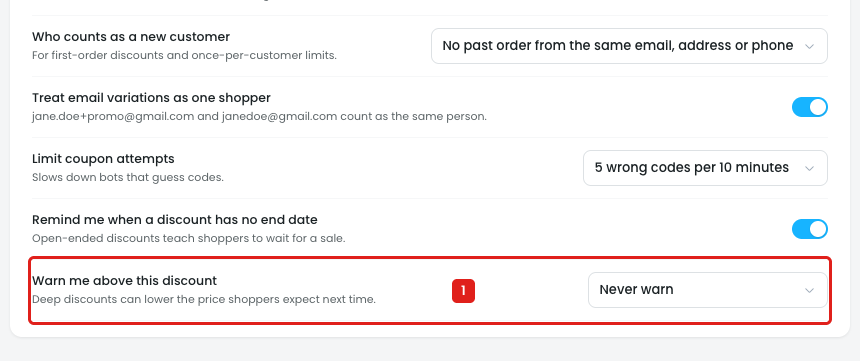
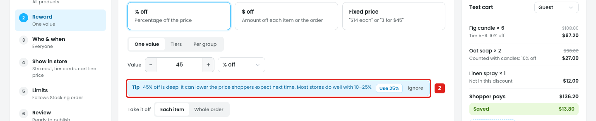
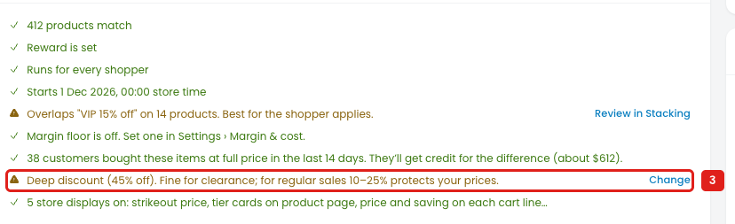
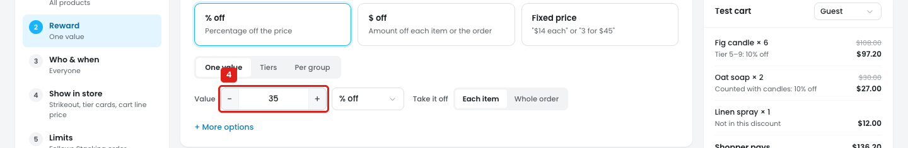

# Settings → General: "Warn me above this discount" is ignored by the discount builder

The setting chooses when Disco warns about a deep discount: 40% off, 30% off, 50% off or Never warn. The discount builder doesn't use it. It always warns above 40%, whatever is picked.

## Issue 1: "Never warn" still warns

**Steps:** Settings → General → Warn me above this discount → Never warn

1. **"Never warn" is picked (marker 1).**

**Steps:** Settings → General → Warn me above this discount → Never warn → Campaigns → Discounts → New discount → Store-wide or category sale → Reward → % off → 45

2. **The Reward step still shows the tip (marker 2):** *"45% off is deep. It can lower the price shoppers expect next time. Most stores do well with 10–25%."* with **Use 25%** / **Ignore**.

**Steps:** Settings → General → Warn me above this discount → Never warn → Campaigns → Discounts → New discount → Store-wide or category sale → Reward → % off → 45 → Review

3. **The Review step still lists "Deep discount (45% off)" (marker 3),** with a warning icon and Change.

The same happens with **50% off** picked: 45% still gets both warnings.

## Issue 2: "30% off" doesn't warn at 35%

**Steps:** Settings → General → Warn me above this discount → 30% off → Campaigns → Discounts → New discount → Store-wide or category sale → Reward → % off → 35

4. **35% off is entered (marker 4),** above the 30% set in Settings, and there's no tip here or on the Review step. The builder only warns above a fixed 40%.

Other points about the setting:

- **The options are out of order:** 40% off, 30% off, 50% off, Never warn.
- **Only fixed values:** a store can't pick 20%, 25% or 60%.
- **Only % off is checked.** A $ off or fixed-price discount that takes 50% off an item isn't checked.

## Suggestion

- **Use the setting in the builder:** the Reward tip and the Review line appear only above the value in Settings, and never with **Never warn**. Say where it comes from: *"Above your 30% warning level (Settings › General). Change"*.
- **Check every reward type** by the % it takes off the price: % off, $ off, fixed price, tiers and bundles.
- **Options in order, plus a custom value:** `Never warn` / `20%` / `30%` / `40%` / `50%` / `Custom [__] %`.
