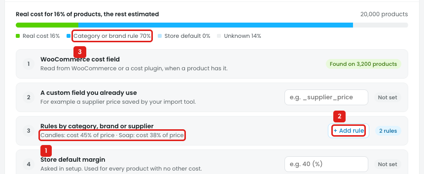

# Settings → Margin & cost: cost rules can't be set up

"Rules by category, brand or supplier" gives a cost to every product in a group that has no real cost, e.g. "Candles cost 45% of the price": a $30 candle gets a cost of $13.50. Disco uses it for margin floor checks and profit in Insights. In the design, the owner can't choose the group or the %.

## Issue

**Steps:** Settings → Margin & cost → Rules by category, brand or supplier → + Add rule → + Add rule

1. **The rules are preset (marker 1).** The 1st click adds "Candles: cost 45% of price", the 2nd adds "Soap: cost 38% of price".
   - There's no form: the owner can't pick category, brand or supplier, which one, or the %.
   - The rules are plain text in one line, with no edit or remove.
   - "% of price" doesn't say if it's the regular price or the sale price. With the sale price, the cost would change whenever a discount runs.
   - When a product matches two rules (e.g. a category and a brand), nothing says which one is used.
2. **"+ Add rule" (marker 2)** adds a rule straight away, without opening anything.
3. **"Category or brand rule 70%" (marker 3)** is the same after 1 rule and after 2 rules. Adding Soap doesn't change the coverage.

## Suggestion

- **"+ Add rule" opens a row to fill in:**
  `[Category ▾ / Brand / Supplier / Tag] [🔍 Search: Candles] cost [45] % of [regular price ▾]` → **Save** / **Cancel**
- **One rule per line, with its product count, Edit and ×:**
  - `Candles · cost 45% of regular price · 1,240 products [Edit] [×]`
  - `Soap · cost 38% of regular price · 610 products [Edit] [×]`
- **Order:** drag or ↑ ↓, with *"If a product matches more than one rule, the first one wins."*
- **Coverage bar** updates from the rules: real cost, rules, store default, unknown.
