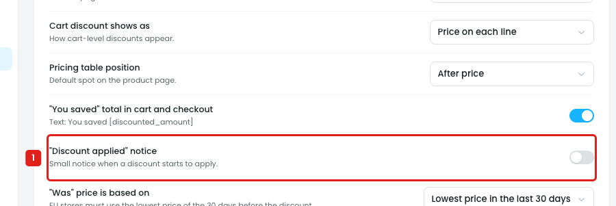
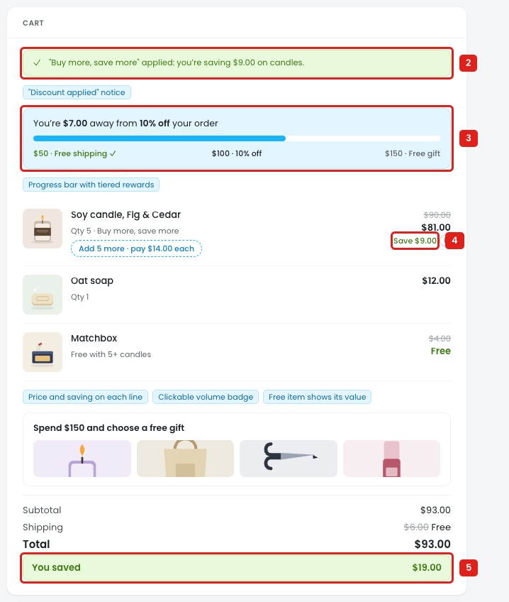
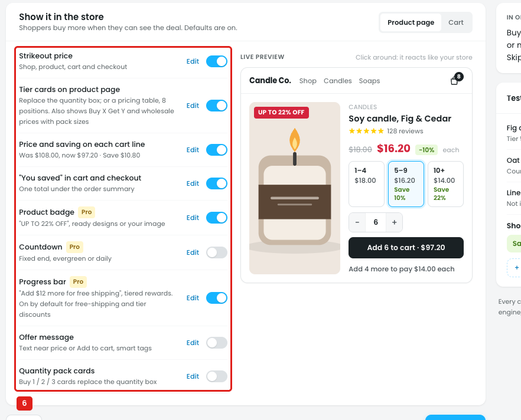

# Settings → Display: "Discount applied" notice is in the wrong place, and the preview ignores it

The notice is a short message in the cart when a discount starts to apply, e.g. *"Buy more, save more" applied: you're saving $9.00 on candles.* It's useful at the moment something changes by itself: a tier unlocks when the quantity goes up, a free item is added, free shipping starts. But it's set in a different place from every other store display, and the cart already shows the same saving several times.

## Issue 1: It's a global switch, not a per-discount display

**Steps:** Settings → Display → "Discount applied" notice

1. **"Discount applied" notice is one on/off switch for the whole store, off by default (marker 1).**
   - It's all discounts or none. It can't be on only for, say, Buy one get one, where a free item appears in the cart by itself.
   - The text can't be changed, and it doesn't say where it shows (toast, bar or cart line) or for how long.

## Issue 2: The preview shows it while it's off, next to 3 other savings displays

**Steps:** Store preview → Product & cart

2. **The cart shows the notice (marker 2)** although the setting is off. It's also shown when the setting is turned on, so the preview doesn't follow it.
3. **The progress bar (marker 3),**
4. **the saving on the cart line (marker 4)**
5. **and "You saved" (marker 5)** already tell the shopper about the same discount. With the notice, the saving is shown 4 times in one cart.

## Issue 3: It's missing from the builder's Show in store step

**Steps:** Campaigns → Discounts → New discount → Volume tiers → Show in store

6. **Every other store display is set per discount in the builder (marker 6):** Strikeout price, Tier cards, Price and saving on each cart line, "You saved", Product badge, Countdown, Progress bar, Offer message, Quantity pack cards. The "Discount applied" notice isn't in this list.

## Suggestion

- **Move the notice into the builder's Show in store step,** next to "Price and saving on each cart line":
  `"Discount applied" notice [on/off] · Edit` → text with smart tags, e.g. `[discount_name] applied: you're saving [discounted_amount]`, and where it shows (toast / bar above the cart).
- **Keep only the default in Settings:** *"New discounts show the 'Discount applied' notice: on/off"*.
- **Turn it on by default only where something changes by itself:** a free item is added, a tier unlocks, a coupon applies from a link.
- **Join it with the progress bar** when both are on: the bar changes to *"Unlocked: 10% off applied"* instead of a separate notice.
- **The store preview follows the setting:** hide the notice when it's off.
