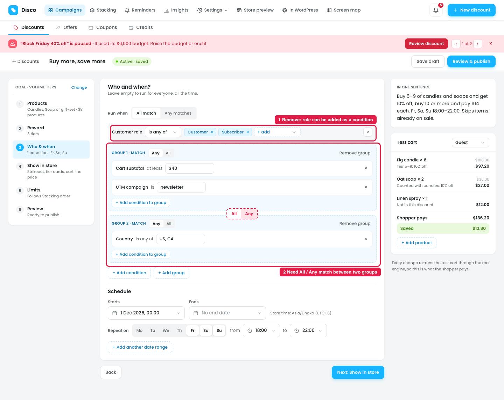
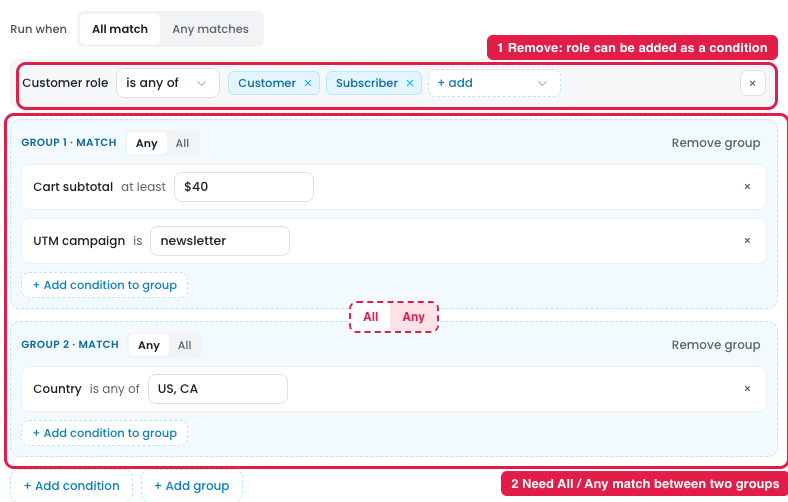

# Builder: Who & when tab

## 1. Remove the separate Customer role row under "Run when" (marker 1)

**Steps:** Campaigns → Discounts → Buy more, save more → Who & when → Run when → Customer role

"Customer role" is shown as its own row under **Run when**. It isn't needed: customer role can be set as a normal condition through **+ Add condition**. Remove the dedicated row and add role through conditions like any other rule.

## 2. All / Any match between two groups (marker 2)

**Steps:** Campaigns → Discounts → Buy more, save more → Who & when → + Add group (to get two groups)

When there are two condition groups, there should be an **All / Any** match option between them, so the user can choose whether both groups must match (All) or either one is enough (Any). The dashed red **All / Any** control between Group 1 and Group 2 in the screenshot shows where it should go.
