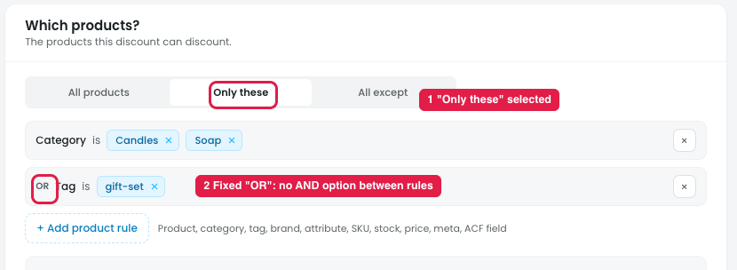
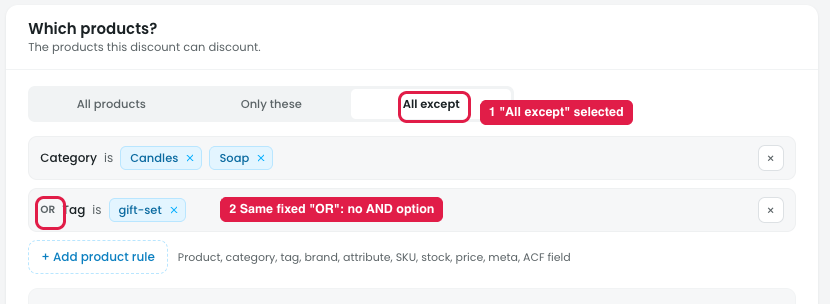

# Products → Only these / All except: rules can only be joined with OR, not AND

## Issue

**Steps:** Campaigns → Discounts → Buy more, save more → Products → Only these

In **Products → Only these** (marker 1), product rules are always joined with **OR** (marker 2). "OR" is fixed text and can't be switched to **AND**.

So the owner can only build "Category is Candles **or** Tag is gift-set". A rule like "Category is Candles **and** Tag is gift-set" (only candles that are also gift sets) isn't possible.

Common cases that need AND:
- Category is Hoodies **and** Brand is Nike
- Category is Candles **and** Stock status is In stock
- Tag is summer **and** Price is over $20

## Same issue in "All except"

**Steps:** Campaigns → Discounts → Buy more, save more → Products → All except

**Products → All except** (marker 1) has the same fixed **OR** (marker 2). The owner can only exclude "Category is Candles **or** Tag is gift-set". They can't exclude "Category is Candles **and** Tag is gift-set" (only candles that are gift sets), so they can't narrow down what to leave out.

Example that needs AND here: exclude **Category is Electronics and Stock status is Low stock** (all products except low-stock electronics).

## Suggestion

- **Make the joiner switchable in both "Only these" and "All except":** a **Match: All (AND) / Any (OR)** control above the rules, the same pattern as "Run when: All match / Any matches" in Who & when.
- **Optionally, allow groups** for mixed logic, e.g. (Category is Candles **and** In stock) **or** Tag is gift-set.
- **Update "38 products match"** right away when the joiner changes, so the owner sees the effect.
