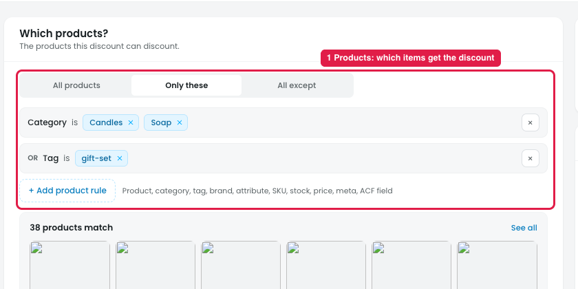
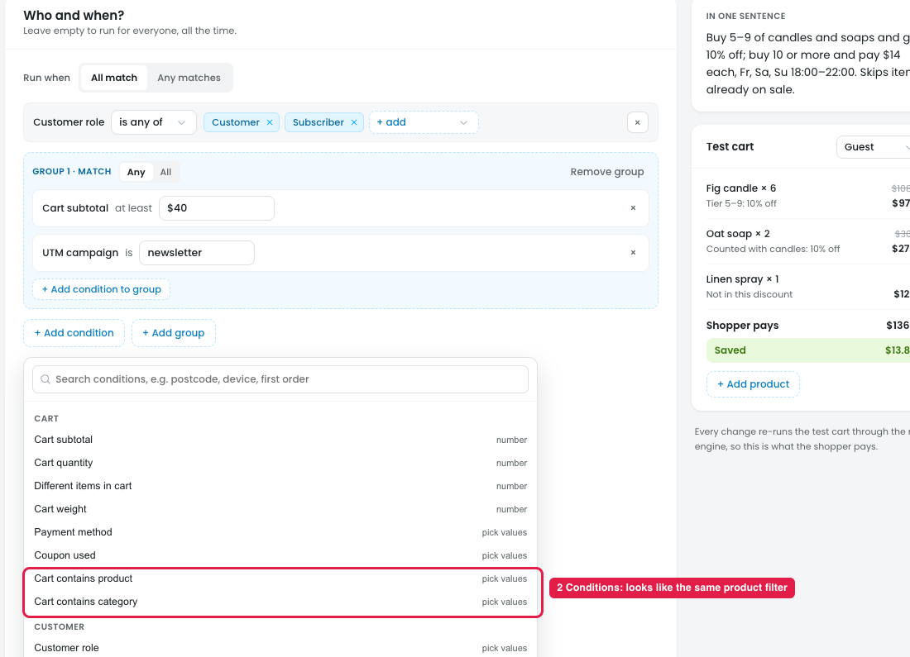

# Builder: Product filters (Products) vs. conditions (Who & when)

The Products step has product filters, and the Who & when step also has product-based conditions. The two steps do different jobs, but the screens don't explain the difference, so they read as the same filter shown twice.

## The difference

**Steps:**
- Products filter: Campaigns → Discounts → Buy more, save more → Products → Only these
- Conditions: Campaigns → Discounts → Buy more, save more → Who & when → + Add condition → Cart → Cart contains product / Cart contains category

- **Products (marker 1) decides which items get the discount.** For example, "Category is Candles, Soap": only candles and soap are discounted, and any other item in the cart stays full price.
- **Conditions (marker 2) decide whether the discount turns on at all.** They check the shopper, cart, time or traffic source (role, cart subtotal, UTM, country, day and time). If a condition fails, nothing is discounted.

Some conditions look like the same filter: **Cart contains product** and **Cart contains category**.

- Products "Category is Candles" means the candles **get the discount**.
- Condition "Cart contains category Candles" means the discount **turns on only if a candle is in the cart**. The discounted items are still the ones picked in Products.

Both are needed for a rule like "discount soap only when a candle is in the cart", but nothing on screen explains this.

## Suggestion

Keep both, and make the difference clear in the labels:

- Step 1 title: **"Which items get the discount"**
- Step 3 title: **"When the discount turns on"**
- Rename the product conditions to **"Required in cart: product"** and **"Required in cart: category"**, so they don't look like the Products filter.
