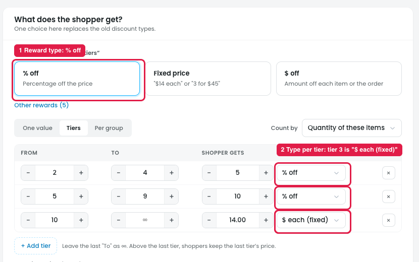
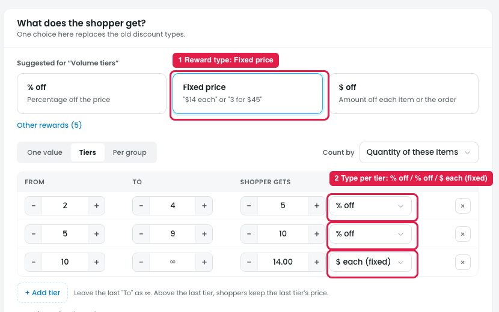
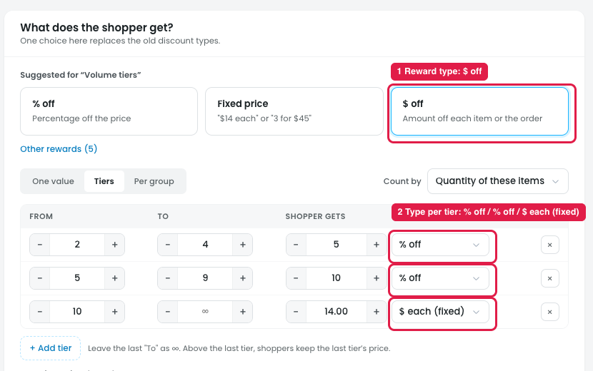

# Builder: Reward type vs. type per tier

> **Update:** decided later to keep a type dropdown in every tier row (% off / $ off / $ off each / Fixed price each), without the duplicate. See [23-v2-tiers-type-and-count.md](23-v2-tiers-type-and-count.md).

**% off selected:**

## The issue

**Steps:** Campaigns → Discounts → Buy more, save more → Reward → % off (or Fixed price / $ off) → Tiers → type dropdown in each tier row

The reward type is chosen twice, and the two choices can conflict.

- **Marker 1:** at the top, the reward type is set once. The **% off** card is selected ("Percentage off the price").
- **Marker 2:** under **Tiers**, each row has its own type dropdown. Tiers 1 and 2 are "% off", but tier 3 (10+) is **"$ each (fixed)"**.

So the page says the discount is "% off", while one tier is actually a fixed price. The top choice gets quietly overridden. The user can't tell which one wins, or what happens to the tier rows when the top card is switched to "Fixed price" or "$ off".

The same happens with **Fixed price** and **$ off**. The top card changes, but the tier rows stay "% off / % off / $ each (fixed)", so the selected reward type has no effect on the tiers.

**Fixed price selected:**

**$ off selected:**

Mixing types across tiers already has its own template, **"Mixed-reward tiers"**, on the Create a discount page.

## Suggestion

- **When % off is selected:** the tier rows show only a number with a fixed "% off" unit, and no type dropdown.
- **When Fixed price or $ off is selected:** the same, with that type's unit.
- **For mixed types per tier:** add a separate **"Mixed"** option, or allow it only in the Mixed-reward tiers template. The per-tier type dropdown appears only then.
