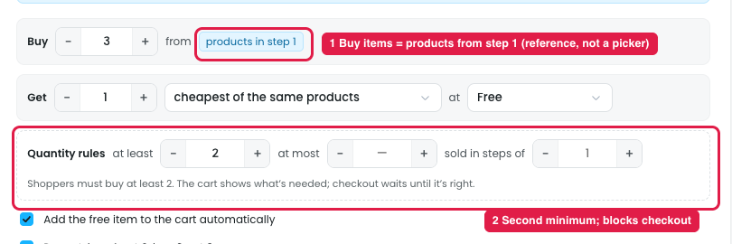

# Builder: Free or cheaper item, "Buy from products in step 1" and "Quantity rules"

## 1. "Buy … from products in step 1" (marker 1)

**Steps:** Campaigns → Discounts → Buy more, save more → Reward → Other rewards → Free or cheaper item → Switch → Buy … from products in step 1

The "Buy" items are the products picked in step 1 (Products): Candles, Soap or gift-set. "Buy 3 from products in step 1" means the shopper must buy 3 items from that list.

**The issue:**
- The chip is only a reference, not a picker. To change which products count, the user has to go back to step 1, and nothing here explains that.
- You can't set different "Buy" products on this screen. A rule like "Buy candles, get soap" only works by choosing soap under "Get → specific products".

## 2. "Quantity rules: at least / at most / sold in steps of" (marker 2)

**Steps:** Campaigns → Discounts → Buy more, save more → Reward → Other rewards → Free or cheaper item → Switch → Quantity rules

These are purchase limits:

- **at least:** the minimum the shopper must buy. Below it, checkout is blocked ("checkout waits until it's right").
- **at most:** the maximum they can buy.
- **sold in steps of:** pack sizes, e.g. 6, 12, 18.

This is a wholesale feature (minimum order, pack sizes). It isn't part of buy X get Y.

**The issue:**
- **Two minimums on one screen.** "Buy 3" already sets how many items are needed for the free item. "At least 2" adds a second minimum, and the two numbers can conflict.
- **It blocks checkout instead of withholding the discount.** A shopper who buys only 1 can't check out at all, when they should just not get the free item.
- **Blocking checkout already has its own reward.** The design has a separate "Restrict purchase" reward ("Block checkout until a rule is met"), so Quantity rules don't belong inside Free or cheaper item.
