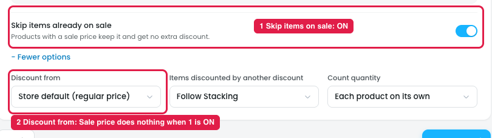
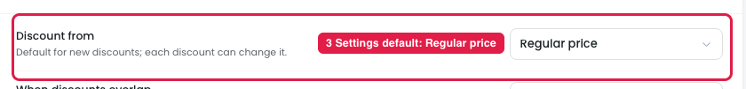
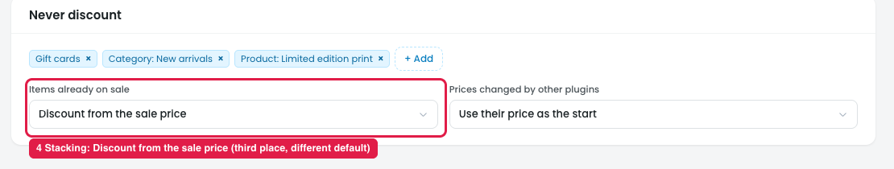

# "Discount from" is set in three places

The price a discount starts from (regular or sale price) can be set in three places, and each one shows a different default.

## Where it appears

**Products step → More options (markers 1–2)**

**Settings → General (marker 3)**

**Stacking → Never discount (marker 4)**

## Issues

**Steps:**
- Campaigns → Discounts → Buy more, save more → Products → + More options → Discount from
- Settings → General → Discount from
- Stacking → Never discount → Items already on sale

1. **It conflicts with "Skip items already on sale" (markers 1–2).** In the Products step, "Skip items already on sale" is ON, so sale items aren't discounted at all. Picking "Discount from: Sale price" right below then does nothing.
2. **The same setting is in three places (markers 2, 3, 4):** Products → More options, Settings → General, and Stacking → Never discount ("Items already on sale").
3. **The defaults disagree.** Settings and Products say **Regular price**, while Stacking says **Discount from the sale price**. It isn't clear which one applies.
4. **The options don't match either.** Stacking offers "Skip them" and "Whichever is cheaper for the shopper", which Settings and Products don't have.
5. **Few owners need it per discount.** Most stores set this once for the whole store.

## Suggestion

- **Keep one store-wide setting** in Settings, and remove the copies from Products and Stacking.
- **Merge "Skip items already on sale" and "Discount from" into one control:** "Items on sale: Skip them / Discount from sale price / Discount from regular price / Whichever is cheaper for the shopper".
- **Per-discount override (only if needed):** if a discount really needs its own value, show this one control under More options in the Products step, with the store default preselected and labelled "Store default (…)".
