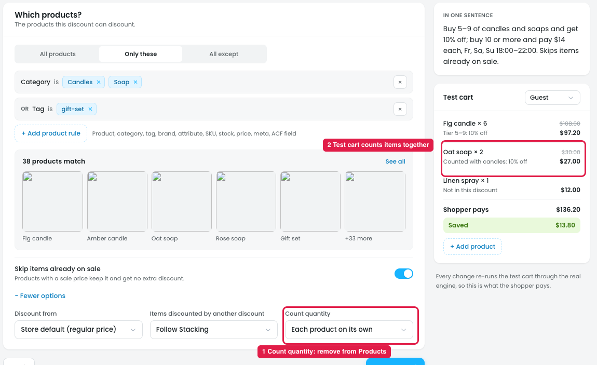
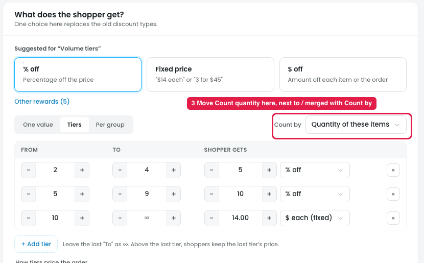

# "Count quantity" should move from Products to Reward

## Where it is now: Products step → More options (markers 1–2)

## Where it should go: Reward step, next to "Count by" (marker 3)

## What "Count quantity" does

It decides how matching items are counted toward a quantity-based reward. The options are: Each product on its own / Variations of a product together / All matching products together / Per category.

Example: tier "5–9 items → 10% off", with 3 Fig candles + 3 Amber candles in the cart.

- **Each product on its own:** 3 and 3. Neither reaches 5, so no discount.
- **All matching products together:** 6, so 10% off.

## When it's needed

| Discount | Needs Count quantity? |
|---|---|
| Store-wide / product sale, One value (e.g. 30% off) | No. Each item is discounted on its own. |
| Cart discount by subtotal (e.g. spend $100, get 10% off) | No. It uses the money total. |
| Cart discount by "Quantity in the cart" | No. It already counts the whole cart. |
| Free shipping, fee, set cart total | No. |
| Tiers counted by "Quantity of these items" | **Yes** |
| Buy X get Y / BOGO | **Yes** |
| Fixed price for a set ("3 for $45"), quantity packs | **Yes** |

## Issues

**Steps:**
- Campaigns → Discounts → Buy more, save more → Products → + More options → Count quantity
- Campaigns → Discounts → Buy more, save more → Reward → Tiers → Count by

1. **It's in the wrong step (marker 1).** It sits in Products, before the reward is chosen, and is shown for every discount, even ones where it does nothing.
2. **It duplicates "Count by" (marker 3).** The Reward step already has "Count by: Quantity of these items / Quantity in the cart / Cart subtotal / Item price". That's two counting controls in two steps.
3. **It contradicts the test cart (marker 2).** Products is set to "Each product on its own", but the test cart shows Oat soap ×2 "Counted with candles: 10% off", which is "All matching products together".

## Suggestion

- **Remove it from Products.** That step stays about which items get the discount.
- **Put it in the Reward step**, next to "Count by", or merge the two into one control.
- **Show it only for quantity-based rewards**: Tiers by item quantity, Buy X get Y, fixed price for a set, and quantity packs. Hide it for everything else.
