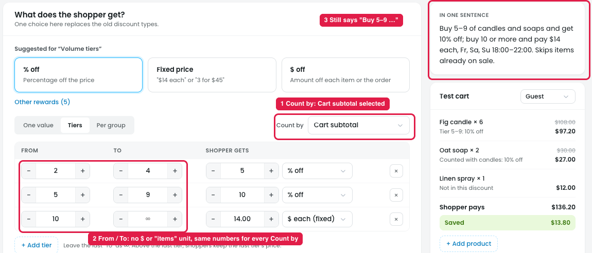
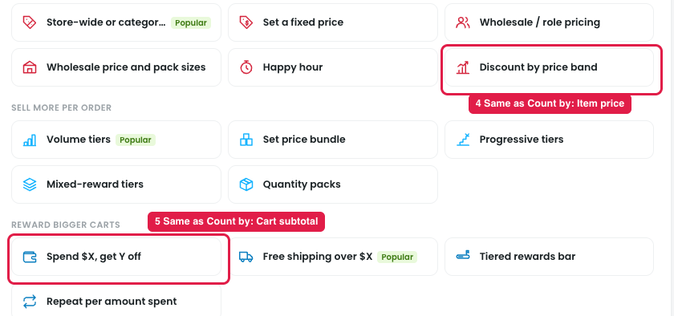

# Reward step: "Count by" in tier discounts

In the Reward step, choosing **Tiers** gives rows like "From 2 To 4 → 5% off". The **Count by** dropdown tells the system what "2" and "4" mean.

| Count by | "From 2 To 4" means | Example |
|---|---|---|
| Quantity of these items | 2 to 4 **candles/soaps** (the step 1 products) | Buy 2–4 candles → 5% off |
| Quantity in the cart | 2 to 4 items of **anything** in the cart | Any 2–4 items in the cart → 5% off candles |
| Cart subtotal | **$2 to $4** cart total | Cart $50–$99 → 5% off |
| Item price | Items that **cost $2 to $4** each | Cheap items get 5%, expensive items get 10% |

## Problems

**Steps:**
- Campaigns → Discounts → Buy more, save more → Reward → Tiers → Count by → Cart subtotal (or Item price)
- Campaigns → Discounts → New discount → Put products on sale → Discount by price band
- Campaigns → Discounts → New discount → Reward bigger carts → Spend $X, get Y off

1. **The fields don't change (markers 1–2).** With Count by set to "Cart subtotal", the rows still show 2–4, 5–9, 10+ and there's no "$" sign. The owner can't tell whether "2–4" means 2–4 items or $2–$4.
2. **The summary doesn't change (marker 3).** It still says "Buy 5–9 candles…" even when counting by money.
3. **The same discount can be made in two places (markers 4–5).**
   - Tiers + Cart subtotal = the **"Spend $X, get Y off"** template.
   - Tiers + Item price = the **"Discount by price band"** template.
4. **Quantity is counted in two settings.** "Count quantity" (in Products) and "Count by" (in Reward) both decide how items are counted (see [07-count-quantity.md](07-count-quantity.md)).

## Suggestion

- **Show "$" or "items" next to the numbers**, depending on Count by.
- **Make the summary match**, e.g. "Spend $50–$99, get 5% off".
- **Keep Count by for quantity (items) only.** Cart total tiers and item price tiers already have their own templates.
- **Merge "Count quantity" into this one dropdown.**

## Suggested renames

| Now | Rename to |
|---|---|
| Count by | **Tiers based on** |
| Quantity of these items | **Number of these products** |
| Quantity in the cart | **Number of items in the cart** |
| Cart subtotal | **Cart total ($)** |
| Item price | **Each item's price ($)** |
| FROM / TO (column headers) | **From / To**, with the unit shown: "From (items)" or "From ($)" |
