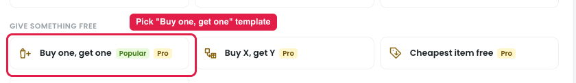
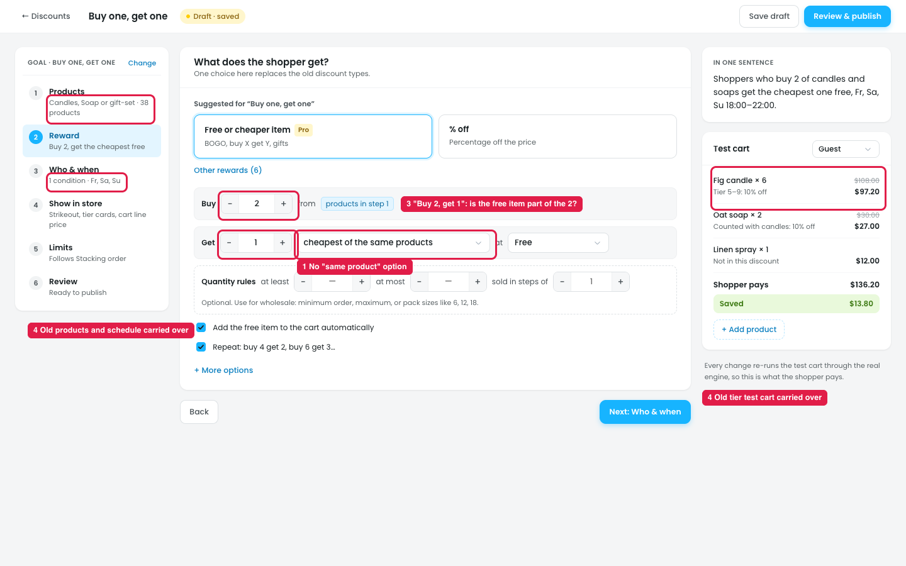

# Buy X get X (same product free) can't be set up

## How you'd try it now

1. **Create a discount → Give something free → "Buy one, get one"** (Pro).
2. **Products:** choose the products, e.g. Candles.
3. **Reward:** it's pre-filled with **Free or cheaper item**: "Buy 2 from products in step 1", "Get 1 cheapest of the same products", "at Free".
4. **Who & when, Show in store and Limits** work as normal.

## Issues

**Steps:** Campaigns → Discounts → New discount → Give something free → Buy one, get one → Next: Reward → Get

1. **No "same product" option (marker 1).** Buy X get X means "buy a Fig candle, get a **Fig candle** free". The closest option is "cheapest of the **same products**", which means the cheapest item from the whole step 1 list. A shopper who buys a Fig candle ($18) and an Oat soap ($15) gets the soap free, which is not Buy X get X.
2. **It relies on a hidden setting.** It only behaves like Buy X get X if "Count quantity" in Products (under More options) is set to "Each product on its own". Nothing in the Reward step says so.
3. **"Buy 2, get 1" is confusing (marker 3).** The Buy one, get one template shows **Buy 2 / Get 1**, and the summary says "buy 2 … get the cheapest one free". Owners think "Buy 1, get 1". It isn't clear whether the free item is part of the 2 or an extra one.
4. **The template brings in old data (marker 4).** The new draft already has the previous discount's products (Candles, Soap or gift-set), the Fr/Sa/Su schedule, the role condition and the old tier test cart ("Tier 5–9: 10% off").

## Suggestion

- **Add a "Get" option: "the same product"** (or "same product and variation"), and make it the default for the Buy one, get one template.
- **Use the owner's wording:** "Buy **1**, get **1** free", where the free item is extra, with the summary "Buy 1 Fig candle, get another Fig candle free".
- **Start templates with empty or default data**, not the previous discount's.
