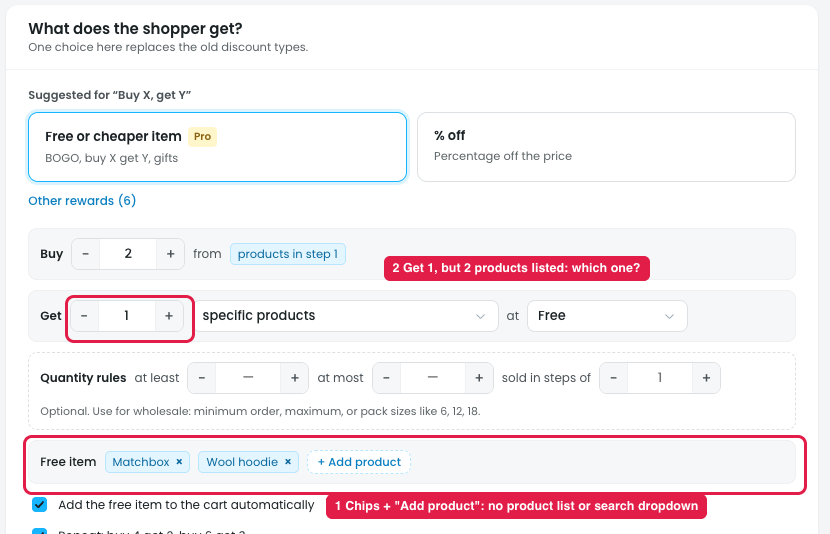

# Buy X get Y: "Get → specific products"

In **Buy X, get Y → Reward → Get: specific products**, the free products are shown as chips ("Matchbox ×", "Wool hoodie ×") with a "+ Add product" button.

## Issues

**Steps:** Campaigns → Discounts → New discount → Give something free → Buy X, get Y → Next: Reward → Get → specific products → + Add product

1. **No product list or search dropdown (marker 1).** "+ Add product" only adds another chip; in the prototype it added "Wool hoodie" straight away. There's no dropdown listing the store's products and no search, so the owner can't see or pick which product to add.
2. **It isn't clear which product the shopper gets (marker 2).** "Get **1**" is set, but two products are listed (Matchbox and Wool hoodie). Nothing says which one becomes free or discounted:
   - the cheapest one?
   - the first one in the list?
   - the shopper chooses?
   - whichever is already in the cart?

## Suggestion

- **Use a searchable product dropdown** (search by name or SKU, with image and price) to pick the "Get" products, instead of the "+ Add product" chip button.
- **When more than one product is listed and Get is less than the number listed, add a rule:** "Which one is free: **Cheapest / Most expensive / Shopper chooses / Any in cart**".
- **Show the choice in the summary**, e.g. "Buy 2 candles, get 1 free: the cheaper of Matchbox or Wool hoodie".
