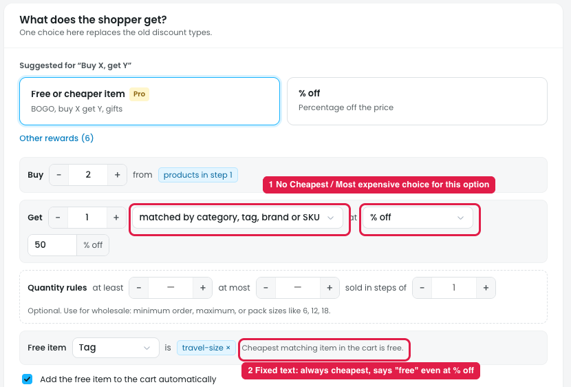

# Buy X get Y: "matched by category, tag, brand or SKU" can't give the most expensive item

## Issues

**Steps:** Campaigns → Discounts → New discount → Give something free → Buy X, get Y → Next: Reward → Get → matched by category, tag, brand or SKU → at → % off

1. **No Cheapest / Most expensive choice (marker 1).** With **Get: matched by category, tag, brand or SKU**, the owner can't give the **highest-priced** matching item free or discounted. Only the "same products" options come in two versions ("cheapest of…" and "most expensive of…"). This option has no such choice.
2. **The helper text is fixed (marker 2).** It always says "Cheapest matching item in the cart is **free**.", even when "at" is set to % off, $ off or a fixed price (the screenshot shows "at 50% off").

## Suggestion

- **Add a "Which one" choice** to this option: **Cheapest / Most expensive** (plus "Shopper chooses" if needed).
- **Make the helper text follow the settings**, e.g. "The most expensive matching item in the cart gets 50% off".
- **Use one shared "Which one" control for every Get option** (same products, specific products, matched by category/tag/brand/SKU), instead of separate "cheapest of…" and "most expensive of…" entries in the dropdown.
