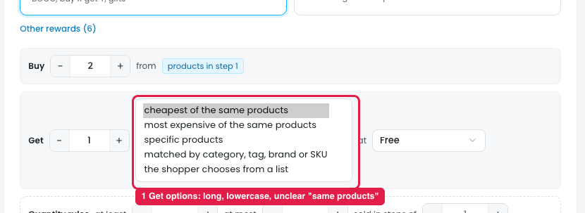

# Buy X get Y: wording in the "Get" dropdown

*Update: the "Get" options work as intended, so no functional change is needed. The only issue is the wording of the options.*

## Issue

**Steps:** Campaigns → Discounts → New discount → Give something free → Buy X, get Y → Next: Reward → Get

*The dropdown is shown opened for the screenshot.*

The "Get" dropdown lists (marker 1):

- cheapest of the same products
- most expensive of the same products
- specific products
- matched by category, tag, brand or SKU
- the shopper chooses from a list

Problems with the wording:

1. **"Same products" is unclear.** It means the products picked in step 1 (the Buy products), but owners can read it as "the same product" (Buy X get X).
2. **The options are long sentence fragments in lowercase**, while other dropdowns use short labels that start with a capital letter (e.g. "% off", "Fixed price each").
3. **"Matched by category, tag, brand or SKU" and "the shopper chooses from a list"** describe how it works instead of naming the option.

## Suggestion

| Now | Change to |
|---|---|
| cheapest of the same products | Cheapest of the Buy products |
| most expensive of the same products | Most expensive of the Buy products |
| specific products | Specific products |
| matched by category, tag, brand or SKU | Products by category, tag, brand or SKU |
| the shopper chooses from a list | Gift list (shopper chooses) |
