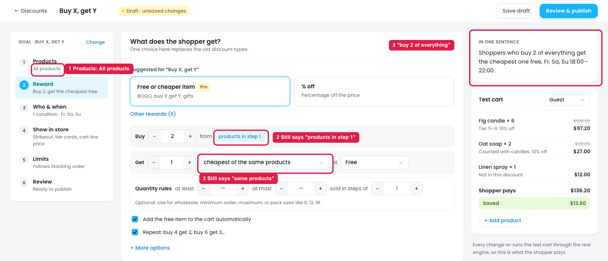

# Buy X get Y with "All products": wording doesn't fit

## Are "cheapest / most expensive of the same products" still needed?

**Yes.** "Same products" means the products picked in the Products step. With **All products** (marker 1), it simply means **any item in the cart**. These two options are the only way to decide which cart item becomes free:

| Option | Meaning with All products | Example (Buy 2, get 1 free) |
|---|---|---|
| Cheapest of the same products | The cheapest item in the cart is free | Hoodie $40 + Socks $10 → **Socks free** |
| Most expensive of the same products | The most expensive item in the cart is free | Hoodie $40 + Socks $10 → **Hoodie free** |

The other Get options do different things (a set product, a category/tag item, or a gift the shopper chooses), so they can't replace these two.

## Issues

**Steps:** Campaigns → Discounts → New discount → Give something free → Buy X, get Y → Products → All products → Next: Reward

1. **The labels don't change (marker 2).** With All products selected, Buy still says "from **products in step 1**" and Get still says "cheapest of the **same products**". For an all-products discount, this wording doesn't make sense to the owner.
2. **The summary reads wrong (marker 3).** "Shoppers who buy 2 of **everything** get the cheapest one free" sounds like 2 of every product.

## Suggestion

- **Make the labels follow the Products step:**

  | Products step | Buy label | Get labels |
  |---|---|---|
  | All products | Buy **2 items** | **cheapest item in the cart** / **most expensive item in the cart** |
  | Only these (e.g. Candles) | Buy **2 from Candles** | **cheapest Candle** / **most expensive Candle** |

- **Fix the summary**, e.g. "Buy any 2 items, get the cheaper one free".
- **Use the shared "Which one: Cheapest / Most expensive" control** suggested in [11-bxgy-matched-cheapest-only.md](11-bxgy-matched-cheapest-only.md), so the Get list only says *where* the item comes from and "Which one" says *which* item.
