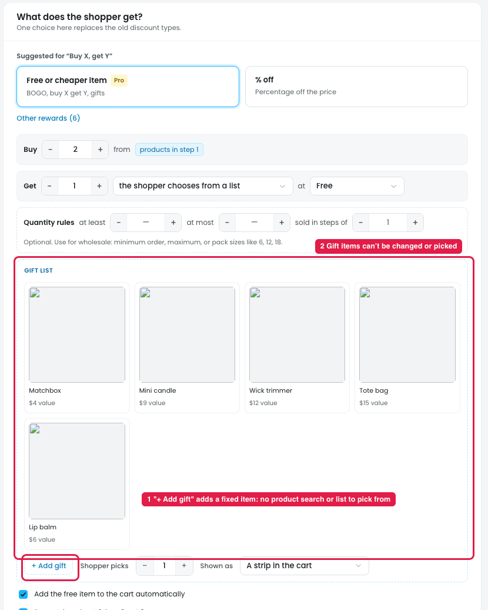

# Buy X get Y: "the shopper chooses from a list", with no way to pick the gift products

With **Get: the shopper chooses from a list**, a **Gift list** appears (Matchbox, Mini candle, Wick trimmer, Tote bag) with a "+ Add gift" button.

## Issues

**Steps:** Campaigns → Discounts → New discount → Give something free → Buy X, get Y → Next: Reward → Get → the shopper chooses from a list → + Add gift

1. **No way to pick which products go in the list (marker 1).** "+ Add gift" only adds another fixed item; in the prototype it added "Lip balm" straight away. There's no product search, dropdown or product list, so the owner can't choose which products the shopper can pick from.
2. **Gift items can't be changed (marker 2).** The gift cards have no remove (×) and no way to swap a product. Once an item is in the list, the owner can't take it out or replace it.

## Suggestion

- **"+ Add gift" should open a searchable product picker** (search by name or SKU, with image and price), the same picker suggested for "specific products" in [10-bxgy-specific-products.md](10-bxgy-specific-products.md).
- **Give each gift card a remove (×)** and allow reordering, so the owner controls what the shopper sees.
- **Optionally, allow a category or tag as the source** (e.g. "any product tagged *gift*"), so the list stays up to date.
