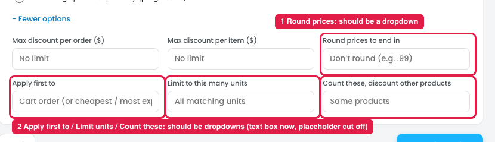

# Reward → More options: choice fields should be dropdowns

## What each field does

| Field | What it does | Example |
|---|---|---|
| Max discount per order ($) | Caps the total discount in one order | 20% off, max $50: a $400 cart gets $50 off, not $80 |
| Max discount per item ($) | Caps the discount on each item | 30% off, max $10: a $100 jacket gets $10 off, not $30 |
| Round prices to end in | Rounds the discounted price to a nice ending | $16.20 → $15.99 |
| Apply first to | When only some units are discounted, decides which ones go first | Cheapest first |
| Limit to this many units | Only this many units get the discount | 50% off, limit 2: buy 5, only 2 are half price |
| Count these, discount other products | Step 1 products count toward the rule, but other products get the discount | Buy 3 candles, get 20% off soaps |

## Issues

**Steps:** Campaigns → Discounts → Buy more, save more → Reward → + More options

1. **"Round prices to end in" is a number input (marker 1).** It has fixed choices (.99, .95, .00 …), so it should be a dropdown.
2. **"Apply first to", "Limit to this many units" and "Count these, discount other products" are text or number inputs (marker 2).** They have fixed choices, so the owner has to guess what to type.
3. **The placeholder is cut off:** "Cart order (or cheapest / most ex…".
4. **"Apply first to" is always shown,** but it only matters when "Limit to this many units" is set.
5. **"Count these, discount other products" repeats Buy X get Y** (Free or cheaper item → Get → specific products / matched by category).

## Suggestion

| Field | Should be | Options |
|---|---|---|
| Max discount per order ($) | Number input with $ prefix | Empty = No limit |
| Max discount per item ($) | Number input with $ prefix | Empty = No limit |
| Round prices to end in | **Dropdown** | Don't round / .99 / .95 / .90 / .00 / Custom… |
| Apply first to | **Dropdown** | Cart order / Cheapest first / Most expensive first |
| Limit to this many units | **Dropdown + number** | All matching units / Limit to… (a number field appears) |
| Count these, discount other products | **Dropdown + product picker** | Same products / Other products… (opens product search) |

- **Show "Apply first to" only when a unit limit is set.**
- **Consider removing "Count these, discount other products"** and leaving it to Buy X get Y. If it stays, use the same searchable product picker.
