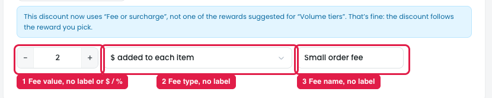

# Fee or surcharge: fields have no labels

After choosing **Reward → Fee or surcharge**, one row of three fields appears. None of them has a label, so it's hard to tell what each one is. The fee value in particular is easy to miss.

## Issues

**Steps:** Campaigns → Discounts → Buy more, save more → Reward → Other rewards → Fee or surcharge → Switch

1. **Fee value (marker 1).** The "− 2 +" stepper is the fee amount, but it has no label and no **$** or **%** next to it.
2. **Fee type (marker 2).** "$ added to each item" has no label. Its options are: $ added to each item / % added to each item / $ fee on the cart / % fee at checkout (e.g. payment method).
3. **Fee name (marker 3).** "Small order fee" is the name the shopper sees on the cart line, but with no label it looks like a value, not a name.

## Suggestion

| Field | Label | Control |
|---|---|---|
| Fee value | **Fee amount** | Number input (not a stepper), with **$** or **%** inside, matching the fee type |
| Fee type | **Add to** | Dropdown: Each item ($) / Each item (%) / Cart ($) / Checkout total (%) |
| Fee name | **Name shown to shopper** | Text input, placeholder "e.g. Small order fee", with helper text "Shown on the cart and checkout line" |

- **Put the fields in this order: Add to → Fee amount → Name shown to shopper.** The type decides the unit, so it should come first.
- **Show a live example under the row**, e.g. "Cart line: *Small order fee* +$2.00".
