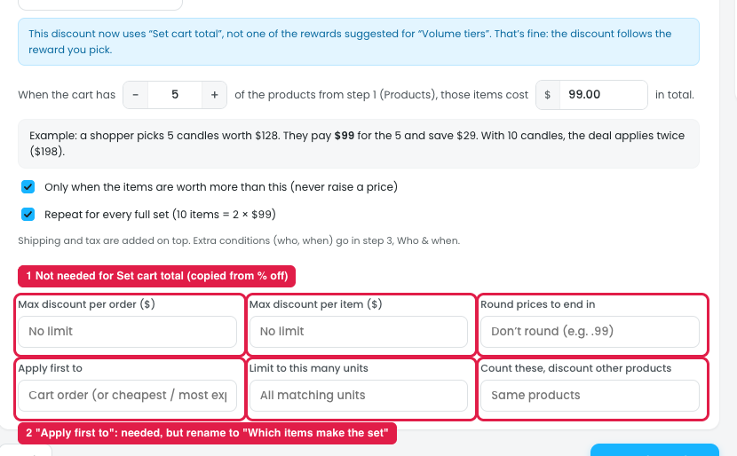

# Set cart total: More options don't fit

The **Set cart total** reward ("Any 5 items for $99") has a clear main panel: a sentence, an example, the "never raise a price" safeguard and the repeat option. But **More options** shows the same six fields copied from % off, and most of them don't apply.

## Issues

**Steps:** Campaigns → Discounts → Buy more, save more → Reward → Other rewards → Set cart total → Switch → + More options

| More option | Needed? | Why |
|---|---|---|
| Max discount per order ($) | ❌ No (marker 1) | The owner already sets the set price ($99). A cap on sets is clearer. |
| Max discount per item ($) | ❌ No (marker 1) | The price is for the whole set, not per item. |
| Round prices to end in | ❌ No (marker 1) | The owner types the final price ($99) directly. |
| Limit to this many units | ❌ Duplicate (marker 1) | "Repeat for every full set" already covers this. |
| Count these, discount other products | ❌ No (marker 1) | The set is made from the step 1 products and priced as one. |
| Apply first to | ⚠️ Needed, but renamed (marker 2) | With 7 candles at different prices in the cart, it decides which 5 make the set. |

## Suggestion

Replace the copied fields with options that fit a set price:

| Option | Control | Purpose |
|---|---|---|
| **Which items make the set** | Dropdown: Cheapest / Most expensive / Cart order | Replaces "Apply first to" |
| **Max sets per order** | Number, empty = No limit | Replaces "Limit to this many units" and "Max discount per order" |
| **How the set price is split across items** | Dropdown: Proportional to price (default) / Equal split | Needed for refunds, tax and invoices (like the VAT example in Settings) |
