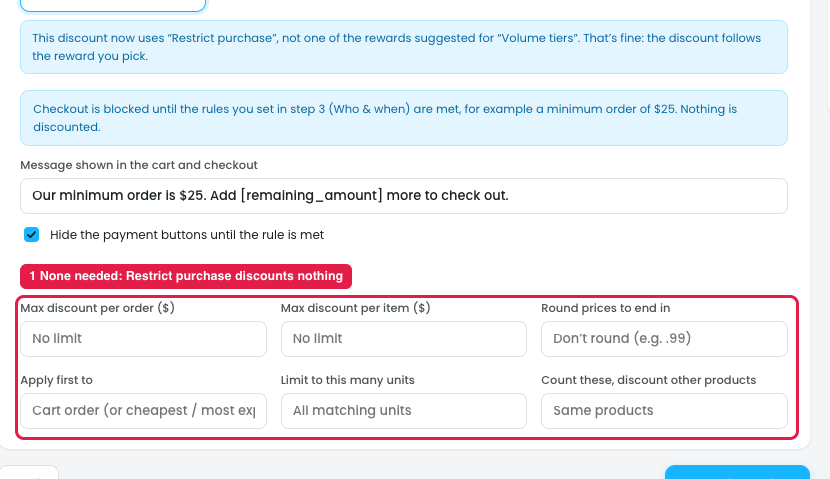

# Restrict purchase: More options aren't needed

**Restrict purchase** blocks checkout until the rules in step 3 (Who & when) are met, e.g. a minimum order of $25. The screen itself says "**Nothing is discounted.**" Its own fields fit the job:

- **Message shown in the cart and checkout**, e.g. "Our minimum order is $25. Add [remaining_amount] more to check out."
- **Hide the payment buttons until the rule is met**

## Issue

**Steps:** Campaigns → Discounts → Buy more, save more → Reward → Other rewards → Restrict purchase → Switch → + More options

**More options shows the six discount fields copied from % off (marker 1).** None of them apply, because this reward doesn't discount anything:

| More option | Why it doesn't apply |
|---|---|
| Max discount per order ($) | No discount is given |
| Max discount per item ($) | No discount is given |
| Round prices to end in | No price changes |
| Apply first to | Nothing to apply to |
| Limit to this many units | Nothing is discounted per unit |
| Count these, discount other products | Nothing is discounted |

## Suggestion

- **Remove "+ More options" from Restrict purchase.** The two fields above are enough.
- **More generally, More options should depend on the reward type.** Show only the fields that apply to the selected reward (see also [16-set-cart-total-more-options.md](16-set-cart-total-more-options.md) and the fee issues in [15-fee-fields.md](15-fee-fields.md)).
