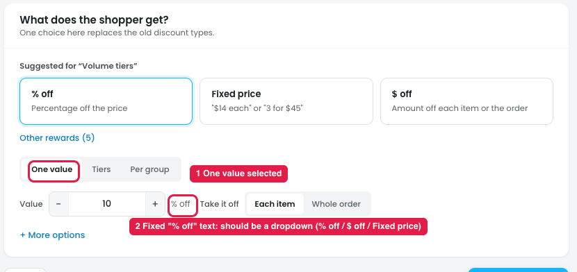

# Reward → One value: the discount type should be a dropdown

## Issue

**Steps:** Campaigns → Discounts → Buy more, save more → Reward → One value

With **One value** selected (marker 1), the value row shows **"10 % off"**, where "% off" is fixed text (marker 2). The only way to change the discount type is to go back up to the % off / Fixed price / $ off cards. In the row itself, the owner can't see or change what the "10" means.

## Suggestion

- **Turn the fixed "% off" text into a discount type dropdown next to the value:** **% off / $ off / Fixed price**.
- **Keep the dropdown and the top cards in sync.** Picking a type in one updates the other. Alternatively, drop the top cards when One value is used, so the type is chosen in one place only.
- **Change the value field to match the type:** "%" for % off, "$" for $ off and Fixed price.
