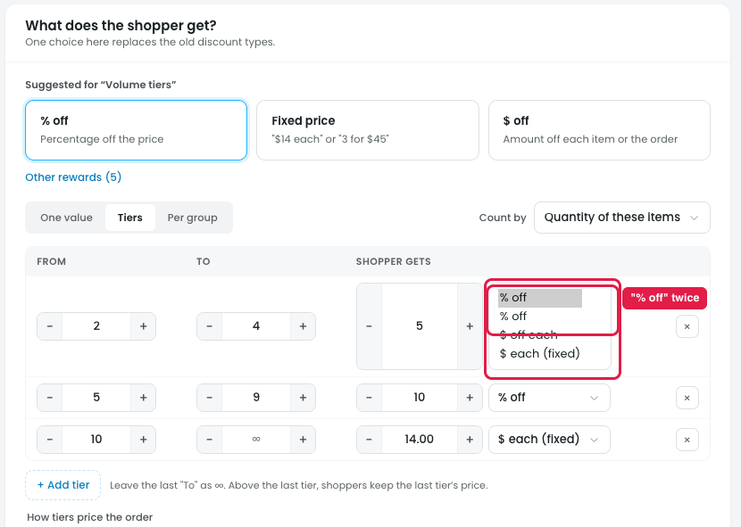

# Discount type dropdown: "% off" listed twice

*The dropdown is shown opened for the screenshot.*

## Issue

**Steps:** Campaigns → Discounts → Buy more, save more → Reward → Tiers → discount type dropdown in a tier row

The discount type dropdown in each tier row lists:

1. % off
2. **% off** ← duplicate
3. $ off each
4. $ each (fixed)

"% off" appears twice. The selected value seems to be added again at the top of the list; tier 3's dropdown, for example, shows "$ each (fixed)" twice. One of the two "% off" entries should be **$ off**.

## Suggestion

- **Remove the duplicate.** The list should be: **% off / $ off / $ each (fixed)**, with no repeated entries.
- **Use the same wording everywhere.** The top cards say "$ off" while the dropdown says "$ off each". Pick one label.
- **Use this same list** for the One value type dropdown suggested in [18-one-value-type-dropdown.md](18-one-value-type-dropdown.md).
