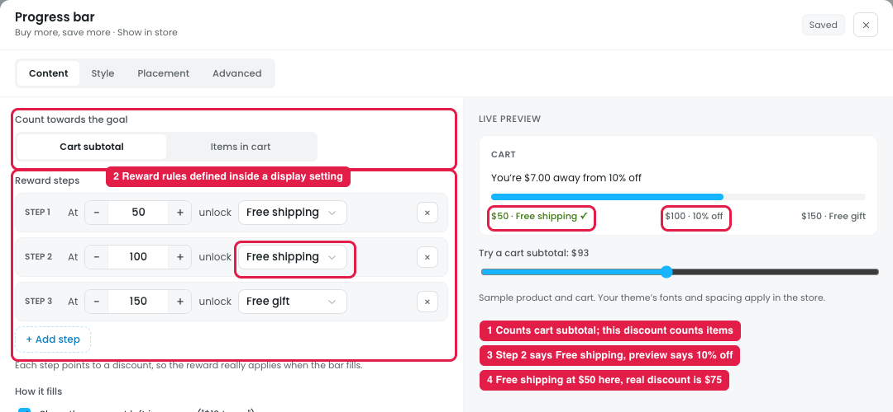
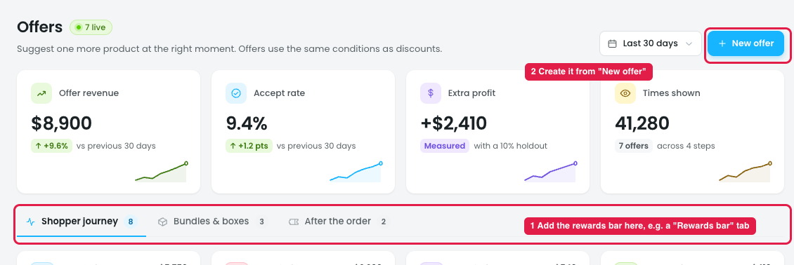
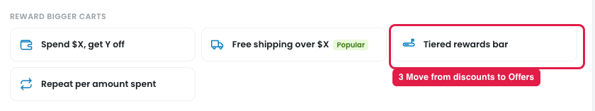
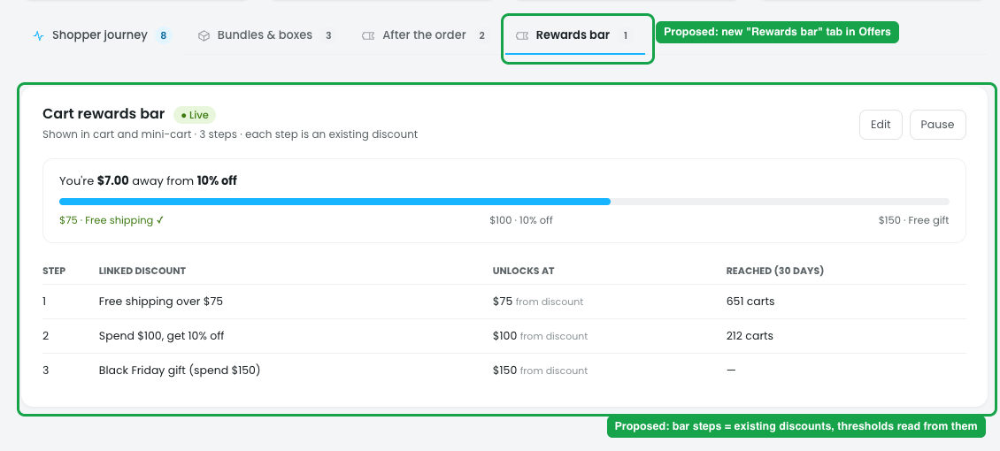
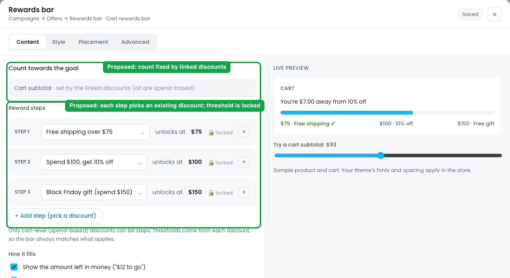
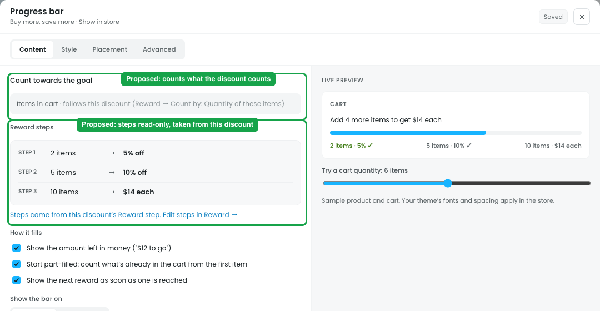

# Show in store → Progress bar: reward steps shouldn't be defined inside a discount

## Issue

**Steps:** Campaigns → Discounts → Buy more, save more → Show in store → Progress bar → Edit

The progress bar editor inside a discount lets the owner set their own **Reward steps**: at $50 unlock Free shipping, at $100 unlock 10% off, at $150 unlock Free gift.

1. **It counts something different from the discount (marker 1).** The bar counts **cart subtotal**, but this discount (Buy more, save more) is volume tiers counted by **item quantity**. The bar's free shipping, 10% off the order and free gift aren't part of this discount.
2. **Reward rules are defined inside a display setting (marker 2).** The progress bar should only **show** progress toward rewards that already exist. It shouldn't create new ones. The helper text says "Each step points to a discount", but the dropdown lists reward types, not actual discounts.
3. **The editor and the preview disagree (marker 3).** Step 2's dropdown says "Free shipping", while the preview shows "$100 · 10% off".
4. **The numbers can clash with real discounts (marker 4).** The bar says free shipping at **$50**, but the real discount is "Free shipping over **$75**". The shopper sees one promise and gets another.

## Suggestion: make the rewards bar its own offer, listed in Campaigns → Offers

**Steps:** Campaigns → Offers

**Steps:** Campaigns → Discounts → New discount → Reward bigger carts → Tiered rewards bar

- **List it in Campaigns → Offers (marker 1).** For example, add a **"Rewards bar"** tab next to Shopper journey / Bundles & boxes / After the order.
- **Create it from "New offer" (marker 2).** Move the "Tiered rewards bar" template from Create a discount → Reward bigger carts to Offers (marker 3), because it shows several rewards rather than being a discount itself.
- **Each step picks an existing discount.** The step dropdown lists real discounts (e.g. "Free shipping over $75", "Spend $100, get 10% off"), not reward types.
- **Each threshold comes from the linked discount,** so the bar and the discount can't disagree.
- **Only cart-level discounts are offered as steps** (subtotal-based), so all steps use the same scale.
- **Remove "Reward steps" from the progress bar inside a single discount's Show in store.** There, the bar shows that discount's own steps read-only (e.g. "2 items → 5%, 5 items → 10%, 10 items → $14 each"), with a link "Edit steps in Reward →". It counts what the discount counts (items or subtotal), and the editor keeps only Style, Placement, messages and fill options.

## Mockups (proposed design)

*These are drawn on top of the prototype to show the suggestion. Green boxes = proposed changes.*

### 1. Rewards bar listed in Campaigns → Offers

**Steps:** Campaigns → Offers → Rewards bar

- A new **Rewards bar** tab sits next to Shopper journey / Bundles & boxes / After the order.
- The bar card shows a live preview and a table of steps. Each step is a **linked discount**, with its threshold read from that discount and how many carts reached it.

### 2. Rewards bar editor: steps pick existing discounts

**Steps:** Campaigns → Offers → Rewards bar → Cart rewards bar → Edit

- Each step is a **dropdown of existing discounts** (e.g. "Free shipping over $75"), not a reward type.
- **"Unlocks at" is locked** and shows the discount's own threshold ($75, $100, $150).
- **"Count towards the goal" is fixed** by the linked discounts (cart subtotal), so it can't be changed by mistake.
- "+ Add step" only offers cart-level (spend-based) discounts.

### 3. Progress bar inside a single discount: read-only steps

**Steps:** Campaigns → Discounts → Buy more, save more → Show in store → Progress bar → Edit

- **Steps are read-only** and come from this discount's Reward step (2 items → 5% off, 5 items → 10% off, 10 items → $14 each), with a link "Edit steps in Reward →".
- **"Count towards the goal" follows the discount** (items in cart, because Count by is "Quantity of these items").
- The preview uses this discount's own steps ("Add 4 more items to get $14 each").
