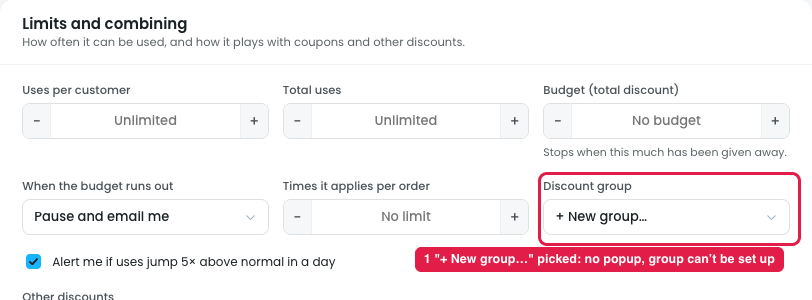
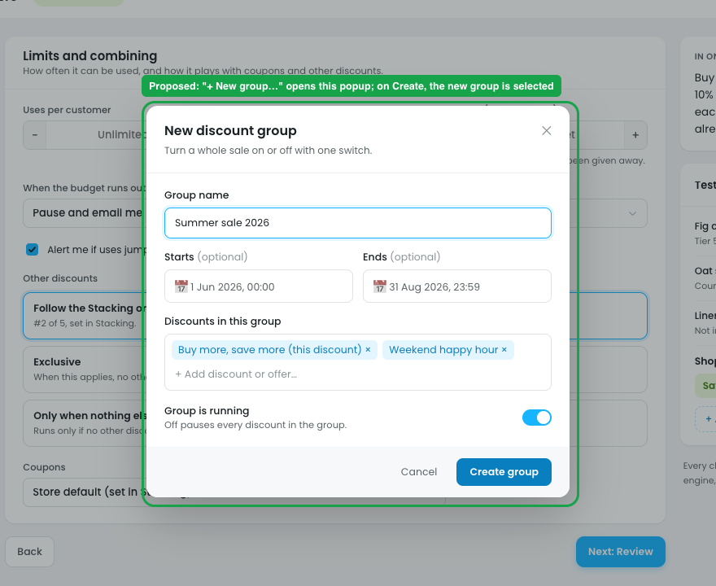

# Limits → Discount group: "+ New group…" should open a popup

## Issue

**Steps:** Campaigns → Discounts → Buy more, save more → Limits → Discount group → + New group…

The **Discount group** dropdown lists No group / Black Friday 2026 / Wholesale / **+ New group…**. Picking "+ New group…" (marker 1) only puts that text in the dropdown. Nothing opens, so the owner can't name the group, set its dates, or choose which discounts belong to it. The group ends up selected with no name.

## Suggestion

**Steps:** Campaigns → Discounts → Buy more, save more → Limits → Discount group → + New group… → popup opens

Picking **"+ New group…"** should open a **New discount group** popup:

| Field | Control | Notes |
|---|---|---|
| Group name | Text input | Required, e.g. "Summer sale 2026" |
| Starts / Ends | Date-time pickers | Optional, for a sale that runs on set dates |
| Discounts in this group | Multi-select of existing discounts and offers | The current discount is added automatically |
| Group is running | Toggle | Off pauses every discount in the group (same as Stacking → Discount groups) |

- **Create group** saves it, closes the popup, and selects the new group in the dropdown.
- **Cancel** closes the popup and goes back to the previous choice (e.g. "No group").
- The new group also appears in **Stacking → Discount groups**, where all groups are managed.
