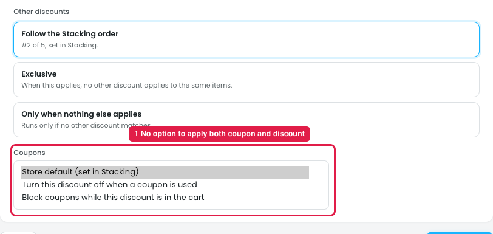
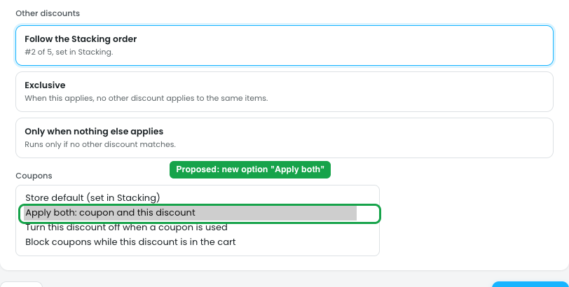

# Limits → Coupons: no "Apply both" option

## Issue

**Steps:** Campaigns → Discounts → Buy more, save more → Limits → Coupons

*The dropdown is shown opened for the screenshot.*

The **Coupons** dropdown (marker 1) has only:

1. Store default (set in Stacking)
2. Turn this discount off when a coupon is used
3. Block coupons while this discount is in the cart

There's no option to **apply both** the coupon and this discount for this discount specifically. The only way is "Store default", which depends on Stacking. If the store default is "Coupon wins" or "Block coupons", one discount can't be set to allow both.

## Suggestion

**Steps:** Campaigns → Discounts → Buy more, save more → Limits → Coupons → Apply both: coupon and this discount

Add the option **"Apply both: coupon and this discount"**, so the per-discount list matches the three store-wide choices in Stacking (Keep both / Coupon wins / Block coupons):

| Option | Matches Stacking choice |
|---|---|
| Store default (set in Stacking) | whatever the store uses |
| **Apply both: coupon and this discount** (new) | Keep both |
| Turn this discount off when a coupon is used | Coupon wins |
| Block coupons while this discount is in the cart | Block coupons |

- **Show what "Store default" currently means,** e.g. "Store default (Keep both)", so the owner knows without opening Stacking.
