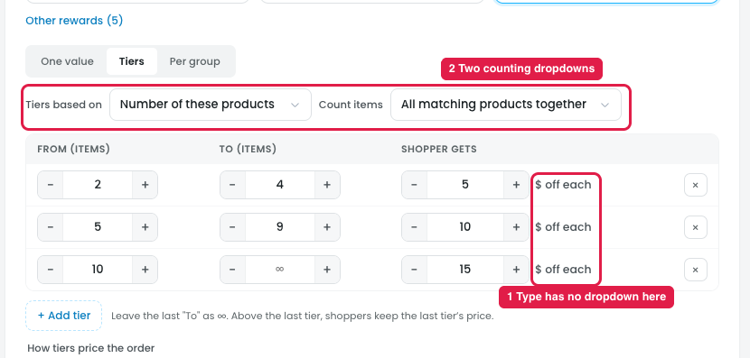
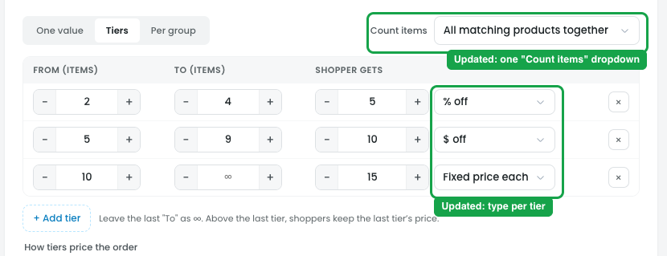

# v2 Reward → Tiers: no type dropdown, and two counting dropdowns

*Follow-up on design-v2 (after notes 04, 07, 08 and 18 were applied).*

## Issue

**Steps:** design-v2 → Campaigns → Discounts → Buy more, save more → Reward → $ off → Tiers

1. **The type has no dropdown here (marker 1).** Each tier row shows "$ off each" as plain text, copied from the card at the top, so every tier must use the same type and "$ off" (a fixed amount, not per item) is missing.
2. **Two dropdowns count items (marker 2).** "Tiers based on" (Number of these products / Number of items in the cart) sits next to "Count items" (All matching products together / Each product on its own / …). Both decide how items are counted, and "Tiers based on" has only two options, one of which is rarely needed.

## Suggestion (done in design-v2)

**Steps:** design-v2 → Campaigns → Discounts → Buy more, save more → Reward → Tiers

- **A discount type dropdown in every tier row**, so each tier can have its own type, with all four types:
  - % off
  - $ off
  - $ off each
  - Fixed price each

  The summary and the progress bar follow each tier's type, e.g. "2–4 get 5% off; 5–9 get $10 off; 10 or more pay $15 each".
- **"Tiers based on" removed and merged into one "Count items" dropdown:**
  - All matching products together (default)
  - Each product on its own
  - Variations of a product together
  - Per category
  - All items in the cart
